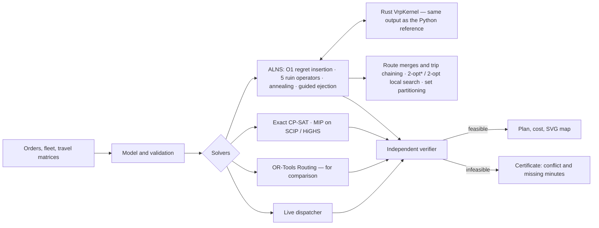

# SynAPS-MobiRoute

A routing engine for mixed fleets: VRPTW, PDPTW and DARP with a capacity vector
(kg, m³, pallets), vehicle requirements, shifts, own and hired vehicles,
drivers' rest rules, several trips per shift and rush-hour travel times. ALNS
on a Rust kernel plus local search, exact CP-SAT and MIP models, a head-to-head
with OR-Tools, live order dispatch — and an independent check of every plan.

Language: [RU](README.md) | **EN** · Site: [konkovdv.github.io/SynAPS-MobiRoute](https://konkovdv.github.io/SynAPS-MobiRoute/)

[](https://github.com/KonkovDV/SynAPS-MobiRoute/actions/workflows/ci.yml)
[](https://www.python.org/)
[](native/mobiroute_native)
[](docs/benchmarks)
[](https://mypy-lang.org/)
[](https://github.com/astral-sh/ruff)
[](LICENSE)

Every plan — from a heuristic, an exact model or OR-Tools — goes through a
separate verifier that recomputes loads, timing and cost and trusts nothing a
solver reports. When a trip cannot be scheduled you get a **certificate**
instead of "infeasible": which constraints conflict and **how many minutes are
missing**.


## Results

| Claim | Result | Reproduce |
| --- | --- | --- |
| 130 public instances: Solomon (VRPTW), Li & Lim and Sartori–Buriol (PDPTW, real OSRM road times), Cordeau (DARP) | all 130 plans verified, every order served. Solomon: **56 of 56** at the best-known vehicle count, median gap 0.50%, 20 matches, worst 7.0%. Sartori–Buriol: 22 of 25, median 0.92%. Cordeau: 19 of 48 at the published optimum, mean gap 0.50% | `python benchmark/vrp_benchmark.py` → [table](docs/benchmarks/vrp-public-benchmarks.md) |
| ALNS against proven optima | CP-SAT proved the optimum of 40 of 40 random instances of the full model (2–3 vehicle types, capacity vector, skills, ride limits, shifts); ALNS finds it on **40 of 40** in 0.15 s (CP-SAT 1.1 s). The two former misses were closed by the operator that merges two routes onto a vehicle of another type | `python benchmark/exact_vs_alns.py` → [table](docs/benchmarks/exact-vs-alns.md) |
| OR-Tools Routing (PCI + GLS) at equal time | 18 instances, 10 s each, one verifier: ALNS is never worse. RC201 +0.79% vs +7.81%; bar-n100-1 (OSRM roads) +0.14% vs +8.61%; one or two vehicles fewer on RC101 and ber-, nyc-, poa-n100-1; on a2-16 OR-Tools drops an order; mixed-fleet cargo days **17–18%** cheaper with two vehicles fewer | `python benchmark/ortools_vs_alns.py` → [table](docs/benchmarks/ortools-vs-alns.md) |
| Orders in real time | an answer in **0.1 ms** on average (95% within 0.22 ms): insertion into the part of a plan not yet driven; an ALNS pass every 30 minutes lowers cost (plant, 140 moves: −1.2%). Re-solving everything with OR-Tools for every order (3 s) accepts 86.4% against 83.6% and is 1.6% cheaper, but answers in 2.9 s — tens of thousands of times slower — and its vehicles arrive 5 minutes later on average. Every final plan verified | `python benchmark/realtime_dispatch.py --with-ortools` → [table](docs/benchmarks/realtime-dispatch.md) |
| Profiling → Rust kernel | ALNS on the Rust kernel runs **10–49×** faster than the Python reference (VRPTW ×10, PDPTW ×17, DARP ×49) with **bit-identical** plans, rests and trips included; ×5.4 on the 8-type cargo day, where operators in Python (type choice, merges) are the bottleneck | `python benchmark/measure_vrp_speed.py` → [table](docs/benchmarks/vrp-speed.md) |
| MIP vs CP on Cordeau a2-16 | CP-SAT proves the optimum 294.25 in 0.7 s; SCIP 26.2 s, HiGHS 41.3 s; CBC keeps a 20% gap at 60 s; LP relaxation 85.27 (weak big-M). ALNS reaches the same optimum in 3.0 s; OR-Tools leaves 1 of 16 requests out in 10 s |
| Solver choice for set partitioning | one set-partitioning model on ALNS route pools, 7 instances, 10 s each: on R101/RC101 SCIP, HiGHS, CBC and 8-worker CP-SAT prove the pool optimum in 0.1–0.4 s; single-thread CP-SAT with default settings does not within 10 s, with `linearization_level=2` it does in 0.1–0.2 s (now the engine's setting); on the multi-trip day all four find a plan **0.29% better than ALNS**; on a 6,339-route pool 8-worker CP-SAT is best (−0.05%), HiGHS without a hint finds nothing and CBC returns a plan 22.6% worse. The LP relaxation bounds the pool from below | `python benchmark/setpart_study.py` → [table](docs/benchmarks/setpart-solvers.md) |
| Drivers' rest rule | a freight-day plan made without the 4.5 h / 45 min rule has, on each of 5 days, **4–6 routes with no room for a rest** (94–209 minutes short in total); the plan made with the rule is feasible at 2.0–5.5% more | `python benchmark/rules_study.py` → [table](docs/benchmarks/rules.md) |
| Several trips per vehicle | DC → 60 stores in two delivery waves: with one trip per vehicle even 21 vehicles (12 hired) serve only 52–55 stores; with two or three trips, **all 60 on 12–15 vehicles** | same |
| Rush hours | a plan made on free-flow speeds fails on **8–13 routes a day** in peak traffic (113–318 minutes late); the traffic-aware plan holds at 0–11% more | same |
| Seeds and statistics | 19 Solomon R2/RC2 instances × 5 seeds: every run at the reference vehicle count, gap spread across seeds up to ±3 pp. Local search shortens the plan in 61 of 95 paired runs (median −0.32% of the best known), Wilcoxon **p = 0.006**; RC202 mean 8.3% → 6.3%, R211 6.5% → 3.9% | `python benchmark/seed_study.py` → [table](docs/benchmarks/seed-study.md) | `python benchmark/solver_lab.py` → [table](docs/benchmarks/solver-lab-a2-16.md) |
| Engineering | 528 tests, 6 of them Hypothesis properties (hundreds of random routes: the search's checks against the independent verifier); `mypy --strict`, `ruff`, `clippy -D warnings`; Rust ↔ Python bit for bit | `pytest && ruff check . && mypy` |

Measured on one machine (Linux x86_64, Python 3.13, single thread); not an SLA.

## What it solves

**City distribution with own and hired vehicles.** Vans, trucks, a tractor;
orders with weight, volume, pallets, a delivery window, refrigeration, a tail
lift or ADR. The solver sends out its own vehicles first and hires only the
class that runs short.

**A DC with delivery waves.** Morning and afternoon store slots; a vehicle
returns to the DC, reloads and leaves for a second trip. Shift, driving limit
and windows hold for the whole day, capacity per trip.

**Drivers' rests and traffic.** At most 4.5 h of driving before a 45-minute
rest, at most 9 h of driving per shift; speeds by time of day (rush hours).
When no rest fits, the verifier says how many minutes are missing.

**In-plant logistics.** Pallet moves between workshops appear during a shift.
Each gets an answer in a fraction of a millisecond: an insertion into the part
of a plan not yet driven, or a refusal with the reason (from the shuttle run:
"the nearest free vehicle reaches the pickup 1.9 min after its window
closes"). Every 30 minutes the live state is re-optimised.

**On-demand shuttle.** Rides between stops: wait at most 30 minutes, wait plus
ride at most 45; eight-seat minibuses.

**Passenger transport with special needs** (DARP): ride limits, wheelchairs,
companions, qualified drivers — the original kernel of the project
([docs/darp-kernel.md](docs/darp-kernel.md)).

## How it works



| Method | When | Proves optimality |
| --- | --- | --- |
| Regret-k insertion + ALNS (random, worst, Shaw, SISR, route; annealing) | default | no |
| Guided ejection (Nagata & Bräysy) | cut the fleet | no |
| Merge two routes onto a vehicle of another type; chain trips through a reload | mixed fleet, several trips | no |
| Local search relocate / swap / 2-opt* / 2-opt, windows in O(1) by segment concatenation (Vidal et al. 2013) | VRPTW, every new best plan | no |
| Set partitioning over the route pool (CP-SAT, SCIP, HiGHS, CBC) | option: recombine routes found | over the pool only |
| Insertion into the live plan | new order during the day | no |
| CP-SAT, one circuit per vehicle | small instances, any constraint | yes, for its integer model |
| Furtado–Munari–Morabito MIP on SCIP / HiGHS / CBC | solver comparison, lower bound | yes, by the backend's proof |
| OR-Tools Routing (PCI + GLS) | baseline | no |
| Minimal lateness: bisection on Bellman–Ford, LP | when windows cannot all be met | yes (LP) |

Constant-time insertion tests: earliest and latest service start at every
stop, loads per dimension, and a closed-form shortest route duration from
prefix and suffix extrema. A driver's rest between two services lengthens one
travel constraint, so the schedule stays a system of difference constraints
and certificates still work; with traffic the arrival function is monotone
(FIFO), so the earliest schedule is still the best one for windows. Lemmas and
proofs: [docs/mathematical-formulation.md](docs/mathematical-formulation.md).

## "Why not?" — a certificate

A freight day, a transfer from a supplier to a customer:

```text
The trip cannot be scheduled: short by 8.8 min.
supplier: start no earlier than 09:00 (loading 26 min);
drive supplier -> customer: 162.8 min;
customer: unloading must start by 12:00.
```

By hand: 540 + 26 + 162.8 − 720 = 8.8. The certificate is a negative cycle of
the difference-constraint graph; its weight is the deficit, and the planner
sees what to change: the customer's window or the supplier's hours.


## Quick start

```bash
python -m pip install -e ".[dev]"
python -m pip install maturin
python -m maturin develop --release --manifest-path native/mobiroute_native/Cargo.toml
```

```bash
mobiroute vrp-solve --generate cargo --orders 120 --out-dir out-cargo --svg
mobiroute vrp-solve --instance benchmark/instances/sartori-buriol/n100/bar-n100-1.txt --time-limit 10 --out-dir out-sb --svg
mobiroute vrp-solve --generate cargo --orders 60 --solver ortools --time-limit 10 --out-dir out-ortools
mobiroute vrp-dispatch --day plant --policy insertion+alns --out-dir out-plant
mobiroute literature-benchmark --instance benchmark/instances/cordeau/a2-16.txt --out-dir out-a2 --svg
pytest            # fast suite; exact MIP proofs: pytest -m slow
```

```python
from mobiroute.vrp import AlnsConfig, load_benchmark, solve

inst, sha256 = load_benchmark("benchmark/instances/solomon/R101.txt")
result = solve(inst, AlnsConfig(time_limit=10, seed=1))
print(result.verdict.summary())
```

Without the compiled Rust kernel the engine runs on its Python reference
implementation, with the same results, only slower.

## Documentation

| Document | About |
| --- | --- |
| [docs/cargo-vrp.md](docs/cargo-vrp.md) | cargo VRP: model, algorithms, scenarios, next steps (RU, EN summary) |
| [docs/mathematical-formulation.md](docs/mathematical-formulation.md) | model, O(1) insertion, difference constraints, rests, trips, traffic (lemmas with proofs), local search, set partitioning, lateness LP, CP-SAT, MIP, how results are compared |
| [docs/architecture.md](docs/architecture.md) | modules, data flow, design decisions |
| [docs/native-acceleration.md](docs/native-acceleration.md) | profiling and the Rust kernels |
| [docs/benchmark-protocol.md](docs/benchmark-protocol.md) | rules for published numbers |
| [docs/benchmarks/](docs/benchmarks) | tables of every experiment |
| [docs/darp-kernel.md](docs/darp-kernel.md) | paratransit DARP kernel: rules, dispatch, checks |
| [docs/limitations.md](docs/limitations.md) | what the engine does not do yet |
| [benchmark/instances/README.md](benchmark/instances/README.md) | provenance and citations of the instances |

## Limits

Public benchmarks and synthetic days; no customer data and no pilot. One rest
per shift; traffic is one speed profile for the whole network and runs on
the Python reference; OR-Tools, the exact model and the live dispatcher do not
model these rules and refuse such instances with an explicit error. Heuristics
prove no optimum: the gap to the best known solution is published per
instance, and the spread over seeds is measured. Details:
[docs/limitations.md](docs/limitations.md).

## License

MIT — see [LICENSE](LICENSE). Citation: [CITATION.cff](CITATION.cff).
