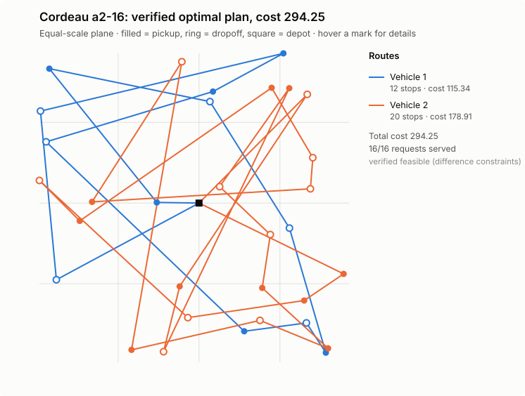
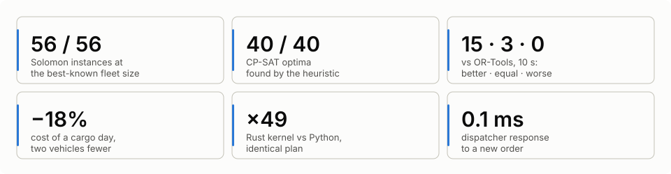
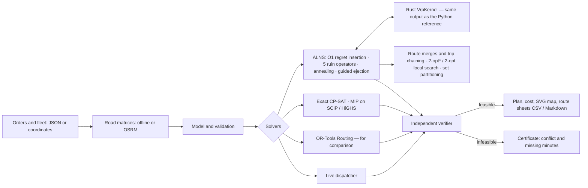
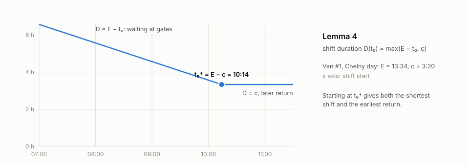
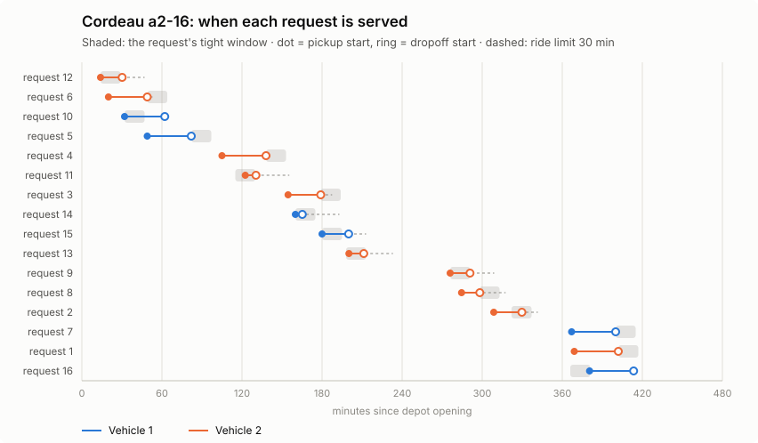
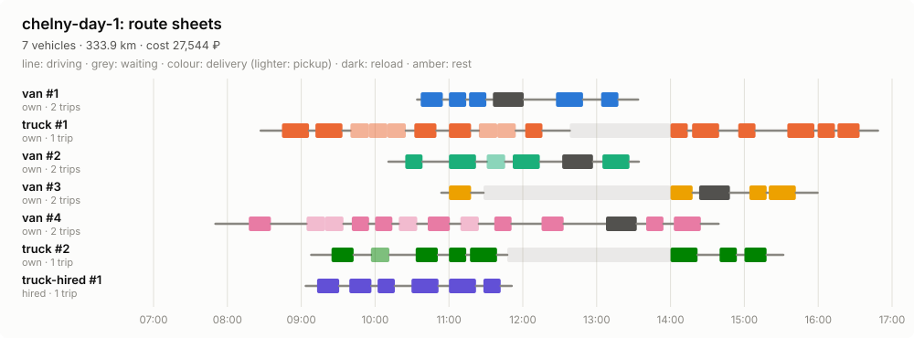

# SynAPS-MobiRoute

A routing engine for mixed fleets: VRPTW, PDPTW and DARP with a capacity vector
(kg, m³, pallets), vehicle requirements, shifts, own and hired vehicles,
drivers' rest rules, several trips per shift and rush-hour travel times. ALNS
on a Rust kernel plus local search, exact CP-SAT and MIP models, a head-to-head
with OR-Tools, live order dispatch, input in coordinates with OSRM and
Valhalla road matrices, truck access zones and route sheets — and an
independent check of every plan.

> **In short.** An open engine that routes a mixed fleet of trucks and vans,
> own and hired: delivery windows, weight, volume and pallets, drivers'
> working-time rules (the 15 + 30 min split break included), several trips a
> shift, zones closed to heavy vehicles. An independent program checks every
> plan, and each driver gets a route sheet. Against Google OR-Tools at equal
> time: better on 15 of 18 instances, worse on none; freight days 17–18%
> cheaper with two vehicles fewer. Python and Rust, about 600 tests, docs in
> Russian and English, an interactive [site](https://konkovdv.github.io/SynAPS-MobiRoute/).
> Author: Dmitrij Konkov ([GitHub](https://github.com/KonkovDV)).

Language: [RU](README.md) | **EN** · Site: [konkovdv.github.io/SynAPS-MobiRoute](https://konkovdv.github.io/SynAPS-MobiRoute/)

[](https://github.com/KonkovDV/SynAPS-MobiRoute/actions/workflows/ci.yml)
[](https://www.python.org/)
[](native/mobiroute_native)
[](docs/benchmarks)
[](https://mypy-lang.org/)
[](https://github.com/astral-sh/ruff)
[](LICENSE)

Every plan — from a heuristic, an exact model or OR-Tools — goes through a
separate verifier that recomputes loads, timing and cost and trusts nothing a
solver reports. When a trip cannot be scheduled you get a **certificate**
instead of "infeasible": which constraints conflict and **how many minutes are
missing**.



## The job's tasks → where they are in the repository

The repository is built around the tasks of an algorithm developer in freight
logistics: VRP with time windows, pickup and delivery and a heterogeneous
fleet; the choice of MIP/CP solvers, heuristics and metaheuristics; product
code, code review and documentation. Every row leads to code and to a
measurement that one command reproduces.

| Task | What is done | Where to check |
| --- | --- | --- |
| VRP with time windows, pickup and delivery, heterogeneous fleet | one model for VRPTW, PDPTW and DARP: capacity vector, skills, shifts, own and hired vehicles, driving-time rules with the 15 + 30 split, several trips, rush hours, truck access zones | [model](src/mobiroute/vrp/model.py) · [Solomon 56 of 56](docs/benchmarks/vrp-public-benchmarks.md) |
| Choosing a MIP/CP solver | the same model on CP-SAT, SCIP, HiGHS and CBC, an LP bound; the solver is chosen by measuring on one's own problem class | [Cordeau a2-16](docs/benchmarks/solver-lab-a2-16.md) · [set partitioning](docs/benchmarks/setpart-solvers.md) |
| Heuristics and metaheuristics | regret-k, ALNS with annealing, guided ejection, route merging, local search with O(1) window checks | [40 of 40 optima](docs/benchmarks/exact-vs-alns.md) · [against OR-Tools](docs/benchmarks/ortools-vs-alns.md) |
| LP/IP, graph theory, combinatorial optimization | difference constraints and Bellman–Ford with certificates, min-cost flow for vehicle types, set partitioning, four lemmas with proofs | [formulation](docs/mathematical-formulation.md) · [below](#the-mathematics-on-one-screen) |
| Product code | CLI, input in coordinates, OSRM matrices, route sheets as CSV / Markdown / SVG, error codes, a Rust kernel | [coordinates to route sheets](#from-coordinates-to-route-sheets) |
| Python: OOP, tests, profiling | immutable dataclass models, `mypy --strict`, 590 tests (10 Hypothesis properties), profiling → a Rust kernel 10–49× faster with the same plan | [tests](tests) · [acceleration](docs/native-acceleration.md) |
| Code review and documentation | review rules, CI (ruff, mypy, clippy, tests, CLI smoke runs), documentation in Russian and English, a changelog | [CONTRIBUTING](CONTRIBUTING.md) · [architecture](docs/architecture.md) · [CHANGELOG](CHANGELOG.md) |
| Risk: synthetic data only | public benchmarks, some on real OSRM road times and with 1000 customers; an operator's data comes in as coordinates and the operator's router matrices (OSRM, Valhalla with a truck profile) | [scope](docs/limitations.md) · [Russian practice](docs/trucking-ru.md) |

## Results



| Claim | Result | Reproduce |
| --- | --- | --- |
| 130 public instances: Solomon (VRPTW), Li & Lim and Sartori–Buriol (PDPTW, real OSRM road times), Cordeau (DARP) | all 130 plans verified, every order served. Solomon: **56 of 56** at the best-known vehicle count, median gap 0.50%, 20 matches, worst 7.0%. Sartori–Buriol: 22 of 25, median 0.92%. Cordeau: 19 of 48 at the published optimum, mean gap 0.50% | `python benchmark/vrp_benchmark.py` → [table](docs/benchmarks/vrp-public-benchmarks.md) |
| ALNS against proven optima | CP-SAT proved the optimum of 40 of 40 random instances of the full model (2–3 vehicle types, capacity vector, skills, ride limits, shifts); ALNS finds it on **40 of 40** in 0.15 s (CP-SAT 1.1 s). The two former misses were closed by the operator that merges two routes onto a vehicle of another type | `python benchmark/exact_vs_alns.py` → [table](docs/benchmarks/exact-vs-alns.md) |
| OR-Tools Routing (PCI + GLS) at equal time | 18 instances, 10 s each, one verifier: ALNS is never worse. RC201 +0.79% vs +7.81%; bar-n100-1 (OSRM roads) +0.14% vs +8.61%; one or two vehicles fewer on RC101 and ber-, nyc-, poa-n100-1; on a2-16 OR-Tools drops an order; mixed-fleet cargo days **17–18%** cheaper with two vehicles fewer | `python benchmark/ortools_vs_alns.py` → [table](docs/benchmarks/ortools-vs-alns.md) |
| Orders in real time | an answer in **0.1 ms** on average (95% within 0.22 ms): insertion into the part of a plan not yet driven; an ALNS pass every 30 minutes lowers cost (plant, 140 moves: −1.2%). Re-solving everything with OR-Tools for every order (3 s) accepts 86.4% against 83.6% and is 1.6% cheaper, but answers in 2.9 s — tens of thousands of times slower — and its vehicles arrive 5 minutes later on average. Every final plan verified | `python benchmark/realtime_dispatch.py --with-ortools` → [table](docs/benchmarks/realtime-dispatch.md) |
| Profiling → Rust kernel | ALNS on the Rust kernel runs **10–49×** faster than the Python reference (VRPTW ×10, PDPTW ×17, DARP ×49) with **bit-identical** plans, rests and trips included; ×5.4 on the 8-type cargo day, where operators in Python (type choice, merges) are the bottleneck | `python benchmark/measure_vrp_speed.py` → [table](docs/benchmarks/vrp-speed.md) |
| MIP vs CP on Cordeau a2-16 | CP-SAT proves the optimum 294.25 in 0.7 s; SCIP 26.2 s, HiGHS 41.3 s; CBC keeps a 20% gap at 60 s; LP relaxation 85.27 (weak big-M). ALNS reaches the same optimum in 3.0 s; OR-Tools leaves 1 of 16 requests out in 10 s | `python benchmark/solver_lab.py` → [table](docs/benchmarks/solver-lab-a2-16.md) |
| Solver choice for set partitioning | one set-partitioning model on ALNS route pools, 7 instances, 10 s each: on R101/RC101 SCIP, HiGHS, CBC and 8-worker CP-SAT prove the pool optimum in 0.1–0.4 s; single-thread CP-SAT with default settings does not within 10 s, with `linearization_level=2` it does in 0.1–0.2 s (now the engine's setting); on the multi-trip day all four find a plan **0.29% better than ALNS**; on a 6,339-route pool 8-worker CP-SAT is best (−0.05%), HiGHS without a hint finds nothing and CBC returns a plan 22.6% worse. The LP relaxation bounds the pool from below | `python benchmark/setpart_study.py` → [table](docs/benchmarks/setpart-solvers.md) |
| Drivers' rest rule | a freight-day plan made without the 4.5 h / 45 min rule has, on each of 5 days, **4–6 routes with no room for a rest** (94–209 minutes short in total); the plan made with the rule is feasible at 2.0–5.5% more | `python benchmark/rules_study.py` → [table](docs/benchmarks/rules.md) |
| Several trips per vehicle | DC → 60 stores in two delivery waves: with one trip per vehicle even 21 vehicles (12 hired) serve only 52–55 stores; with two or three trips, **all 60 on 12–15 vehicles** | same |
| Rush hours | a plan made on free-flow speeds fails on **8–13 routes a day** in peak traffic (113–318 minutes late); the traffic-aware plan holds at 0–11% more | same |
| Seeds and statistics | 19 Solomon R2/RC2 instances × 5 seeds: every run at the reference vehicle count, gap spread across seeds up to ±3 pp. Local search shortens the plan in 61 of 95 paired runs (median −0.32% of the best known), Wilcoxon **p = 0.006**; RC202 mean 8.3% → 6.3%, R211 6.5% → 3.9% | `python benchmark/seed_study.py` → [table](docs/benchmarks/seed-study.md) |
| Engineering | 590 tests, 10 of them Hypothesis properties (hundreds of random routes: the search's checks and the route-sheet schedule against the independent verifier); `mypy --strict`, `ruff`, `clippy -D warnings`; Rust ↔ Python bit for bit | `pytest && ruff check . && mypy` |

Measured on one machine (Linux x86_64, Python 3.13, single thread); not an SLA.

## Comparison with alternatives

Capabilities were checked against each project's documentation (2026-11-14);
the measurement is against OR-Tools. Details, sources and the research
literature: [docs/comparison.md](docs/comparison.md) (RU, English summary).

| | This engine | OR-Tools | VROOM | PyVRP | jsprit | Yandex Routing |
| --- | :---: | :---: | :---: | :---: | :---: | :---: |
| Windows, pickup and delivery, mixed fleet | ✓ | ✓ | ✓ | ✓ | ✓ | ◐ |
| Several trips per shift | ✓ | ◐ by hand | n/f | ✓ | n/f | ✓ |
| Break by time at the wheel (4.5 h → 45 min, 15 + 30) | ✓ | ◐ intervals | ◐ windows | Enterprise | n/f | n/f |
| Zones by weight, height, axle load; truck matrices | ✓ zones + Valhalla | — | ◐ through the router profile | — | n/f | n/f |
| Rush hours by time of day | ✓ | n/f | n/f | n/f | ✓ | ✓ |
| Proven optimum on the same model | ✓ | — | — | — | — | n/f |
| Independent check, "why not" certificate | ✓ | n/f | n/f | n/f | n/f | n/f |
| Open source | MIT | Apache-2.0 | BSD-2 | MIT | Apache-2.0 | — |

◐ partly, n/f not found in the documentation. Measured at equal time on 18
instances with one verifier: **ALNS beats OR-Tools on 15, ties on 3, loses on
none**; on mixed-fleet freight days it costs 16.8–18.3% less with two
vehicles fewer. How to choose: PyVRP and VROOM fit classic CVRP/VRPTW
without fleet rules, a commercial service fits a finished dispatcher UI; this
engine fits a model of one's own with driving-time rules, trips, a mixed fleet
and results that can be checked.

## What it solves

**City distribution with own and hired vehicles.** Vans, trucks, a tractor;
orders with weight, volume, pallets, a delivery window, refrigeration, a tail
lift or ADR. The solver sends out its own vehicles first and hires only the
class that runs short.

**From coordinates to route sheets.** Orders and fleet given as coordinates,
road matrices offline or from an OSRM server, and a route sheet per vehicle
out (section [below](#from-coordinates-to-route-sheets)).

**A DC with delivery waves.** Morning and afternoon store slots; a vehicle
returns to the DC, reloads and leaves for a second trip. Shift, driving limit
and windows hold for the whole day, capacity per trip.

**Drivers' rests and traffic.** At most 4.5 h of driving before a 45-minute
rest, at most 9 h of driving per shift; speeds by time of day (rush hours).
When no rest fits, the verifier says how many minutes are missing.

**In-plant logistics.** Pallet moves between workshops appear during a shift.
Each gets an answer in a fraction of a millisecond: an insertion into the part
of a plan not yet driven, or a refusal with the reason (from the shuttle run:
"the nearest free vehicle reaches the pickup 1.9 min after its window
closes"). Every 30 minutes the live state is re-optimised.

**On-demand shuttle.** Rides between stops: wait at most 30 minutes, wait plus
ride at most 45; eight-seat minibuses.

**Passenger transport with special needs** (DARP): ride limits, wheelchairs,
companions, qualified drivers — the original kernel of the project
([docs/darp-kernel.md](docs/darp-kernel.md)).

## How it works



| Method | When | Proves optimality |
| --- | --- | --- |
| Regret-k insertion + ALNS (random, worst, Shaw, SISR, route; annealing) | default | no |
| Guided ejection (Nagata & Bräysy) | cut the fleet | no |
| Merge two routes onto a vehicle of another type; chain trips through a reload | mixed fleet, several trips | no |
| Local search relocate / swap / 2-opt* / 2-opt, windows in O(1) by segment concatenation (Vidal et al. 2013) | VRPTW, every new best plan | no |
| Set partitioning over the route pool (CP-SAT, SCIP, HiGHS, CBC) | option: recombine routes found | over the pool only |
| Insertion into the live plan | new order during the day | no |
| CP-SAT, one circuit per vehicle | small instances, any constraint | yes, for its integer model |
| Furtado–Munari–Morabito MIP on SCIP / HiGHS / CBC | solver comparison, lower bound | yes, by the backend's proof |
| OR-Tools Routing (PCI + GLS) | baseline | no |
| Minimal lateness: bisection on Bellman–Ford, LP | when windows cannot all be met | yes (LP) |

A driver's rest lengthens one travel constraint, so the schedule stays a
system of difference constraints and certificates still work (Lemma 1); with
traffic the arrival function is monotone (FIFO), so the earliest schedule is
still the best one for windows (Lemmas 2 and 3).

## The mathematics on one screen



**The objective is money, not kilometres.** A hire fee $f_k$ (zero for an own
vehicle), a price per kilometre $c^d_k$ and per hour $c^t_k$ for vehicle type
$k$, a penalty $\pi_r$ for an order left out:

```math
\min \sum_{\text{routes}} \Big( f_k + c^d_k \sum d_{ij} + c^t_k \big(\textstyle\sum t_{ij} + \sum s_i\big) \Big) \;+\; \sum_{r\ \text{unserved}} \pi_r
```

**A schedule is a system of difference constraints.** For a fixed order of
stops every rule is an inequality $B_v - B_u \le w_{uv}$ on service starts:

```math
e_i \le B_i \le l_i, \qquad
B_{i+1} \ge B_i + s_i + t_{i,i+1} \;(+\,b \text{ in the rest gap}), \qquad
B_{d_r} - B_{p_r} - s_{p_r} \le L_r, \qquad
B_{\text{end}} - B_{\text{start}} \le T_k
```

The system is feasible if and only if its constraint graph has no negative
cycle. Bellman–Ford finds one, and the cycle $C$ is a certificate: $-\sum_{C} w$
is the number of minutes missing.

**Insertion in constant time** (Savelsbergh 1992). A forward and a backward
pass over the route

```math
\mathrm{begin}_k = \max\big(\mathrm{begin}_{k-1} + s_{k-1} + t_{k-1,k},\; e_k\big), \qquad
\mathrm{late}_k = \min\big(l_k,\; \mathrm{late}_{k+1} - s_k - t_{k,k+1}\big)
```

decide in $O(1)$ whether order $u$ fits between $v_i$ and $v_{i+1}$:
$b_u = \max(\mathrm{begin}_i + s_i + t_{iu},\, e_u) \le l_u$ and
$b_u + s_u + t_{u,i+1} \le \mathrm{late}_{i+1}$.

**Vehicle types of finished routes are a transportation problem.** Route
$\rho$ on type $k$ costs $\mathrm{cost}_k(\rho)$ ($\infty$ if the type does
not fit its capacity, skills or times):

```math
\min \sum_{\rho, k} \mathrm{cost}_k(\rho)\, z_{\rho k}
\quad \text{s.t.} \quad \sum_k z_{\rho k} = 1, \qquad \sum_\rho z_{\rho k} \le n_k, \qquad z \ge 0
```

The constraint matrix is totally unimodular, so the LP optimum is integral and
a min-cost flow solves it, no MIP needed.

**Set partitioning over the pool** $\Omega$ of routes ALNS has found:

```math
\min \sum_{\rho \in \Omega} c_\rho x_\rho + \sum_r \pi_r y_r
\quad \text{s.t.} \quad \sum_{\rho \ni r} x_\rho + y_r = 1 \;\; \forall r, \qquad
\sum_{\rho \in \Omega_k} x_\rho \le n_k, \qquad x \in \{0, 1\}^{\Omega}
```

**When to leave (Lemma 4).** Let $E$ be the earliest return, $c$ the shortest
shift and $U_0$ the latest departure. Leaving at $t_0 \le U_0$, the shift
lasts

```math
D(t_0) = \max\big(E - t_0,\; c\big), \qquad t_0^{*} = E - c .
```

Leaving at $t_0^{*}$ gives the shortest shift and the earliest return at once.
On the synthetic Naberezhnye Chelny day that frees 14.8 hours of shift time a
day with the same routes; the [site](https://konkovdv.github.io/SynAPS-MobiRoute/#sheets)
lets you drag $D(t_0)$ by hand. Proofs of all four lemmas are in
[docs/mathematical-formulation.md](docs/mathematical-formulation.md).

## "Why not?" — a certificate


A freight day, a transfer from a supplier to a customer:

```text
The trip cannot be scheduled: short by 8.8 min.
supplier: start no earlier than 09:00 (loading 26 min);
drive supplier -> customer: 162.8 min;
customer: unloading must start by 12:00.
```

By hand: 540 + 26 + 162.8 − 720 = 8.8. The certificate is a negative cycle of
the difference-constraint graph; its weight is the deficit, and the planner
sees what to change: the customer's window or the supplier's hours.



## From coordinates to route sheets

Orders and fleet can be given the way an ERP exports them: a depot with
opening hours, an order with an "08:00-11:00" window, loading at the depot or
at a supplier, weight, volume and pallets, vehicle requirements; vehicle
types with a shift, a price per kilometre and per hour, a rest rule and a
number of trips. The `mobiroute.vrp.geo.v1` format is described in
[docs/cargo-vrp.md](docs/cargo-vrp.md#данные-из-координат-и-маршрутные-листы)
(RU, with an English summary) and in the docstring of `mobiroute.vrp.geo`.
Travel times and distances come offline (great circle × a detour factor at
the profile's mean speed) or from an [OSRM](https://project-osrm.org/) server:
its `table` service, queried in blocks of 100 points.

```bash
mobiroute vrp-solve --geo examples/chelny-day.geo.json --sheets --lang en --out-dir out-chelny
mobiroute vrp-solve --geo examples/chelny-day.geo.json --osrm http://localhost:5000 --sheets --out-dir out-osrm
```

Besides the plan and the map, every vehicle gets a route sheet:
`route-sheets.md` for people, `route-sheets.csv` for an ERP or dispatch
system, and `route-sheets.svg` is a Gantt chart of the whole day. A sheet
lists arrival, start and end of work at every stop, the load after it per
dimension, reloads between trips, the driver's break and a driving-time check:
the longest drive between breaks, driving in the shift and the shift length
against their limits. The vehicle leaves as late as its earliest possible
return allows instead of waiting an hour at the first customer's gate. That
schedule has the shortest shift duration (Lemma 4 in
[docs/mathematical-formulation.md](docs/mathematical-formulation.md#4d-the-schedule-handed-to-the-driver)),
and the tests hold it to every constraint of the verifier.

> A route sheet is the driver's trip plan, not the statutory waybill ("путевой лист") that Russian law requires for every trip (Road Transport Charter, Federal Law 259-FZ, art. 6; its required details are set by Ministry of Transport Order No. 390 of 28.09.2022: vehicle and driver, odometer readings, medical and technical pre-trip checks). Those details live in the accounting system; the CSV loads into it as the assignment.



```text
## van #1 · own · 2 trips
Start 10:14, departure 10:34, return 13:34; 36.3 km, 73 min driving, 0 min waiting; cost 1,999 ₽
Driving-time rules met: longest drive between breaks 1:13 / 4:30; driving in the shift 1:13 / 9:00; shift 3:20 / 10:00.
Loading order at the depot, reverse of the drops: trip 1: Z011, Z020, Z014; trip 2: Z027, Z002.

| Trip | What               | Order | Where               | Window      | Arrive | Start |   End |     kg |
| ---: | ------------------ | ----- | ------------------- | ----------- | -----: | ----: | ----: | -----: |
|    1 | loading, departure |       | Склад (условн.)     |             |  10:14 | 10:14 | 10:34 | 1427.4 |
|    1 | delivery           | Z014  | Клиент 14 (условн.) | 08:00-11:00 |  10:37 | 10:37 | 10:55 |  645.8 |
|    1 | delivery           | Z020  | Клиент 20 (условн.) | 11:00-14:00 |  11:00 | 11:00 | 11:14 |  371.1 |
|    1 | delivery           | Z011  | Клиент 11 (условн.) | 08:00-18:00 |  11:16 | 11:16 | 11:30 |      0 |
|    2 | reload             |       | Склад (условн.)     | 07:00-20:00 |  11:36 | 11:36 | 12:01 | 1329.1 |
|    2 | delivery           | Z002  | Клиент 2 (условн.)  | 11:00-14:00 |  12:27 | 12:27 | 12:49 |  241.1 |
|    2 | delivery           | Z027  | Клиент 27 (условн.) | 08:00-18:00 |  13:04 | 13:04 | 13:18 |      0 |
|    2 | return             |       | Склад (условн.)     |             |  13:34 | 13:34 | 13:34 |      0 |
```

The example is a synthetic day in Naberezhnye Chelny: a depot, three
suppliers, 45 orders, own and hired vans and trucks. The points are random
inside the city's bounding box and the names are marked "условн."
(conventional): the data describe no company ([generator](examples/make_chelny_day.py)).
ALNS closes the day in 2.2 s with seven vehicles: all four own vans run two
trips, and one hired truck is needed.

## Quick start

```bash
python -m pip install -e ".[dev]"
python -m pip install maturin
python -m maturin develop --release --manifest-path native/mobiroute_native/Cargo.toml
```

```bash
mobiroute vrp-solve --generate cargo --orders 120 --out-dir out-cargo --svg
mobiroute vrp-solve --instance benchmark/instances/sartori-buriol/n100/bar-n100-1.txt --time-limit 10 --out-dir out-sb --svg
mobiroute vrp-solve --generate cargo --orders 60 --solver ortools --time-limit 10 --out-dir out-ortools
mobiroute vrp-dispatch --day plant --policy insertion+alns --out-dir out-plant
mobiroute vrp-solve --geo examples/chelny-day.geo.json --sheets --out-dir out-chelny
mobiroute literature-benchmark --instance benchmark/instances/cordeau/a2-16.txt --out-dir out-a2 --svg
pytest            # fast suite; exact MIP proofs: pytest -m slow
```

```python
from mobiroute.vrp import AlnsConfig, geo, load_benchmark, route_sheets, sheets_markdown, solve

inst, sha256 = load_benchmark("benchmark/instances/solomon/R101.txt")
result = solve(inst, AlnsConfig(time_limit=10, seed=1))
print(result.verdict.summary())

day = geo.load("examples/chelny-day.geo.json")  # or osrm="http://localhost:5000"
plan = solve(day.instance, AlnsConfig(time_limit=10, seed=1))
sheets = route_sheets(day.instance, plan.solution, plan.verdict, day.places)
print(sheets_markdown(sheets, day.instance.dimensions, lang="en", currency=day.currency))
```

Without the compiled Rust kernel the engine runs on its Python reference
implementation, with the same results, only slower.

## Documentation

| Document | About |
| --- | --- |
| [docs/cargo-vrp.md](docs/cargo-vrp.md) | cargo VRP: model, algorithms, input in coordinates, route sheets, scenarios, next steps (RU, EN summary) |
| [docs/mathematical-formulation.md](docs/mathematical-formulation.md) | model, O(1) insertion, difference constraints, rests, trips, traffic, the driver's schedule (lemmas with proofs), local search, set partitioning, lateness LP, CP-SAT, MIP, how results are compared |
| [docs/comparison.md](docs/comparison.md) | comparison with OR-Tools, VROOM, PyVRP, jsprit, Timefold and Yandex Routing; practice and research taken into the engine (RU, EN summary) |
| [docs/architecture.md](docs/architecture.md) | modules, data flow, design decisions |
| [docs/native-acceleration.md](docs/native-acceleration.md) | profiling and the Rust kernels |
| [docs/benchmark-protocol.md](docs/benchmark-protocol.md) | rules for published numbers |
| [docs/benchmarks/](docs/benchmarks) | tables of every experiment |
| [docs/darp-kernel.md](docs/darp-kernel.md) | paratransit DARP kernel: rules, dispatch, checks |
| [docs/trucking-ru.md](docs/trucking-ru.md) | Russian freight practice: driving-time rules, the waybill, road signs and zones, Platon tolls, ADR, and how each maps onto the model (RU, English summary) |
| [docs/benchmarks/solvers.md](docs/benchmarks/solvers.md) | ALNS, PyVRP, VROOM and jsprit on the same instances at equal time |
| [docs/limitations.md](docs/limitations.md) | scope and roadmap |
| [benchmark/instances/README.md](benchmark/instances/README.md) | provenance and citations of the instances |
| [examples/README.md](examples/README.md) | example inputs and how they were made |
| [CHANGELOG.md](CHANGELOG.md) | what changed in every version |

## Scope and roadmap

The engine is tested on public benchmarks (some on real OSRM road times, some
with 1000 customers) and on synthetic days; an operator's own data comes in
through coordinates and the operator's router (OSRM, or Valhalla with a truck
profile). The gap to the best known solution is published per instance, the
spread over seeds is measured, and small instances are solved to proven
optimality. Next: time-of-day truck bans, multi-day trips with daily rest,
split breaks and traffic in the Rust kernel. Details:
[docs/limitations.md](docs/limitations.md); Russian freight practice:
[docs/trucking-ru.md](docs/trucking-ru.md).

## License

MIT — see [LICENSE](LICENSE). Citation: [CITATION.cff](CITATION.cff).
