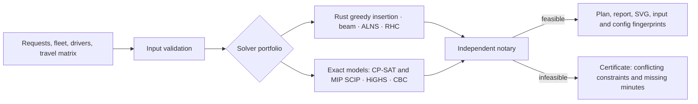

# SynAPS-MobiRoute

A **DARP / PDPTW** routing kernel whose results can be checked: paired
pickup-and-delivery requests with time windows, ride-time limits, a
heterogeneous fleet and request–vehicle–driver compatibility.

Language: [RU](README.md) | **EN** · Site: [konkovdv.github.io/SynAPS-MobiRoute](https://konkovdv.github.io/SynAPS-MobiRoute/)

[](https://github.com/KonkovDV/SynAPS-MobiRoute/actions/workflows/ci.yml)
[](https://www.python.org/)
[](native/mobiroute_native)
[](docs/benchmarks/solver-lab-a2-16.md)
[](https://mypy-lang.org/)
[](https://github.com/astral-sh/ruff)
[](LICENSE)
[](CITATION.cff)

Every published plan is **verified independently**: the timing constraints of
a route form a system of difference constraints, checked by Bellman–Ford apart
from any solver. When a route cannot be scheduled you get a **certificate**
instead of "infeasible": which constraints conflict and **how many minutes are
missing**.


## Reproducible results

| Claim | Result | Command |
| --- | --- | --- |
| Exact model on Cordeau (2006) a2-16 | cost **294.25**, the published proven optimum; CP-SAT **0.5 s** | `mobiroute literature-benchmark --instance benchmark/instances/cordeau/a2-16.txt --out-dir out` |
| MIP vs CP on the same instance | SCIP 24.5 s and HiGHS 37.3 s reach the same optimum; CBC keeps a 20% gap at 60 s; LP relaxation 85.27 (big-M gap 71%) | `python benchmark/solver_lab.py` → [table](docs/benchmarks/solver-lab-a2-16.md) |
| Speed on a large synthetic day | 200 vehicles / 3200 requests: greedy insertion **2.8 s** (47.9 s before profiling); 180 / 2000: **1.6 s** | `python benchmark/run_stress_day.py` |
| Independent notary and red-team tests | hidden onboard waits, forged clocks, overloads are refused | `pytest` |
| Engineering | 460+ tests, `mypy --strict`, `ruff`, `clippy`, Rust ↔ Python oracle parity | `pytest && ruff check . && mypy` |

Measured on the author's machine (Linux x86_64, Python 3.13, single thread);
not an SLA. Method and raw data: [docs/benchmarks](docs/benchmarks/solver-lab-a2-16.md).

## The problem

A dispatcher plans hundreds of requests, each with hard windows, a ride-time
limit, vehicle needs (lift, body type, capacity) and driver needs (licence,
shift, break). Typical failures:

- **silent refusals** of feasible requests. An audit found one here: an
  as-early-as-possible schedule refused 7 of 16 a2-16 requests, each even when
  alone; after the fix, 16 of 16;
- **"optimal" without proof**: the label is set, nobody re-checks the plan;
- **"infeasible" without a reason**: nobody knows whether to move a window, a
  vehicle or a promise;
- **slow re-planning** after cancellations, traffic and breakdowns.

## How it works



| Solver | When | May claim OPTIMAL |
| --- | --- | --- |
| Greedy insertion (Rust kernel via PyO3) | default lane, thousands of requests | no |
| Beam search | bounded branching over insertions | no |
| ALNS (Shaw / worst / route / random destroy, simulated annealing) | improvement | no |
| Rolling horizon | a day in time windows | no |
| CP-SAT tiny (operator algebra) | up to 40 requests | only if OR-Tools proves it **and** the notary is empty |
| Exact CP-SAT (literature algebra) | Cordeau instances | yes, for its integer model; cost recomputed in reals |
| MIP SCIP / HiGHS / CBC (two-index formulation, Furtado–Munari–Morabito 2017) | solver comparison, lower bounds | yes, on the backend's proof |
| Online insertion and recovery | urgent request, cancellation, no-show, traffic, breakdown | no |

## "Why not?" — a certificate

Move one dropoff of the optimal a2-16 plan to the end of its route:

```text
Route 2 cannot be timed: short by 358.68 min. request 12 may ride at most 30 min;
pickup 12 must start by 29; dropoff 1 cannot start before 402;
dropoff 1 -> dropoff 12 takes 3 + 15.68 min (service + travel).
```

By hand: 402 + 3 + 15.68 − (29 + 3 + 30) = 358.68. The certificate is a
negative cycle of the constraint graph: no re-timing of this stop sequence
closes it.


## Quick start

```bash
python -m pip install -e ".[dev]"
python -m pip install maturin
python -m maturin develop --release --manifest-path native/mobiroute_native/Cargo.toml
```

```bash
mobiroute literature-benchmark --instance benchmark/instances/cordeau/a2-16.txt --out-dir out --svg
mobiroute literature-benchmark --instance benchmark/instances/cordeau/a2-16.txt --out-dir out-mip --solver mip --backend SCIP
mobiroute academic-benchmark --instance benchmark/instances/cordeau/a2-16.txt --solver alns --out-dir out-kernel
mobiroute generate --mode medium --seed 42 --out day.json
mobiroute solve --problem day.json --solver greedy --out-dir out-day
pytest            # fast suite; exact MIP proofs: pytest -m slow
```

## Two algebras, never mixed

- **Literature** (Cordeau 2006): real-valued distances, published service
  times, hard windows. Only this lane publishes a gap to a published optimum,
  and only for the byte-identical file (SHA-256).
- **Operator**: integer minutes, 5-minute curb wait, alighting up to 30
  minutes before an appointment. Its plans are never compared with the
  literature, and that is machine-checked: kernel routes become literature-
  feasible exactly when dropoff windows open 30 minutes early.

## Cargo routing

The scheduling algebra carries over (paired pickup/delivery, windows, driver
breaks, insertion, notary); the units change: a capacity vector (kg, m³,
pallets), per-vehicle-type costs, driver shift rules. Stages and acceptance
criteria: [docs/cargo-vrp-porting-plan.md](docs/cargo-vrp-porting-plan.md#english-summary).

## Limits

Synthetic Moscow-zone scenarios and the open Cordeau instance. No operator
data, no pilot, no savings claims (technology readiness level 4: lab
validation). Details: [docs/limitations.md](docs/limitations.md).

## License

MIT — see [LICENSE](LICENSE). Citation: [CITATION.cff](CITATION.cff).
