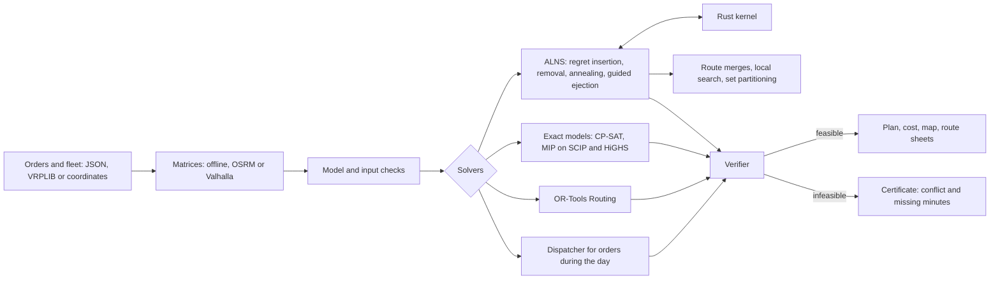
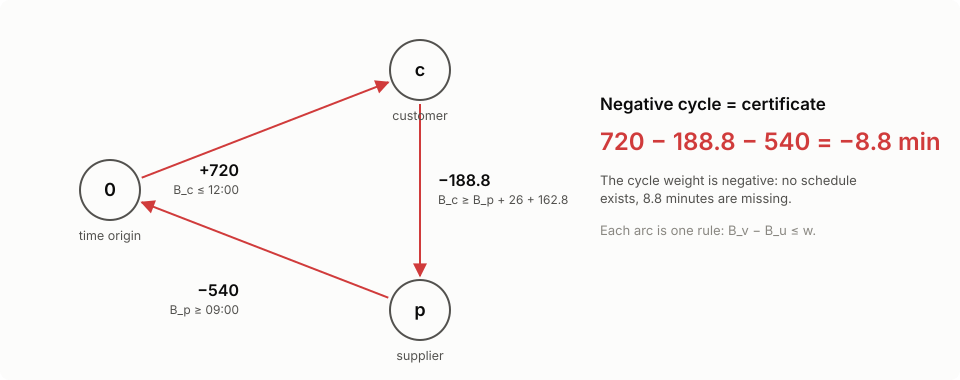

# SynAPS-MobiRoute

A vehicle routing engine for mixed fleets. VRPTW, PDPTW and DARP share one
model: time windows at pickup and delivery, pickup-and-delivery pairs, loads
with weight, volume and pallets, own and hired vehicles of several types,
drivers' driving-time rules, several trips per shift and travel speeds that
change over the day.

The main method is ALNS. Its hot path (inserting orders and checking
schedules) is written in Rust and returns exactly the same plans as the
reference implementation in Python. Small instances are solved exactly with
CP-SAT and MIP models (SCIP, HiGHS, CBC), and OR-Tools Routing runs on the same
model for comparison. Every plan, wherever it comes from, is recomputed by a
separate verifier. When a trip cannot be scheduled, the verifier says which
constraints conflict and how many minutes are missing.

[Русская версия](README.md) · [Site with interactive examples](https://konkovdv.github.io/SynAPS-MobiRoute/)

[](https://github.com/KonkovDV/SynAPS-MobiRoute/actions/workflows/ci.yml)
[](https://www.python.org/)
[](native/mobiroute_native)
[](LICENSE)


## Quick start

```bash
python -m pip install -e ".[dev]"
python -m pip install maturin
python -m maturin develop --release --manifest-path native/mobiroute_native/Cargo.toml
```

The Rust kernel is optional: without it Python computes the same plans, only
slower.

```bash
# a freight day: 120 orders, own and hired vehicles, an SVG route map
mobiroute vrp-solve --generate cargo --orders 120 --out-dir out-cargo --svg

# a day given in coordinates -> route sheets (CSV, Markdown, a Gantt chart)
mobiroute vrp-solve --geo examples/chelny-day.geo.json --sheets --lang en --out-dir out-chelny

# Cordeau a2-16: the exact CP-SAT model and a check of the plan
mobiroute literature-benchmark --instance benchmark/instances/cordeau/a2-16.txt --out-dir out-a2 --svg

pytest          # fast test suite; exact MIP models: pytest -m slow
```

From Python:

```python
from mobiroute.vrp import AlnsConfig, load_benchmark, solve

inst, sha256 = load_benchmark("benchmark/instances/solomon/R101.txt")
result = solve(inst, AlnsConfig(time_limit=10, seed=1))
print(result.verdict.summary())
```

## Model

An order is a pickup-and-delivery pair, a delivery loaded at the depot or a
collection brought back to it. Demand is a vector of any length (kg, m³,
pallets) and vehicle requirements are skills: refrigeration, a tail lift, ADR.
A vehicle type sets the number of vehicles, capacity, depot, shift, speed
profile, hire fee and prices per kilometre and per hour. A hired type differs
from an own one only in price, so the solver hires vehicles of the class that
runs short on its own. The objective is money: hire fees, distance, time and
penalties for orders left out.

Operating rules are constraints of the model, not corrections applied after
solving:

- a 45-minute break after at most 4.5 hours of driving and at most 9 hours of
  driving per shift, including the break split into 15 and 30 minutes (EU
  Regulation 561/2006, Russian Ministry of Transport Order No. 424);
- several trips per shift with a reload at the depot;
- speeds by time of day (the Ichoua, Gendreau and Potvin model, FIFO);
- zones closed to vehicles by gross weight, axle load, height or type;
- a ride-time limit for a pair and a shift length.

The formal model and proofs are in
[docs/mathematical-formulation.md](docs/mathematical-formulation.md); the
freight side in detail is in [docs/cargo-vrp.md](docs/cargo-vrp.md) (Russian,
with an English summary).

## Algorithms

| Method | Used for | Proves optimality |
| --- | --- | --- |
| Regret-k insertion with O(1) checks and ALNS: random, worst, Shaw, SISR and route removal, simulated annealing, adaptive weights | the main search | no |
| Guided ejection (Nagata, Bräysy 2009) | fewer vehicles | no |
| Vehicle types of finished routes as a transportation problem (min-cost flow) | mixed fleets | yes, for the given routes |
| Merging two routes onto a vehicle of another type, chaining trips through the depot | mixed fleets, several trips | no |
| Local search: relocate, swap, 2-opt*, 2-opt with time-window segments (Vidal et al. 2013) | every new best VRPTW plan | no |
| Set partitioning over the route pool (CP-SAT, SCIP, HiGHS, CBC) | recombining routes found so far | over the pool only |
| The dual of its LP relaxation (GLOP) | prices of orders, rents of vehicle types | for the LP |
| CP-SAT, one circuit per vehicle | small instances with any constraint of the model | yes |
| Compact MIP of Furtado, Munari and Morabito (2017) on SCIP, HiGHS, CBC | lower bounds, comparing solvers | yes |
| OR-Tools Routing (PARALLEL_CHEAPEST_INSERTION + GUIDED_LOCAL_SEARCH) | a baseline for comparison | no |
| Insertion into the part of a plan not yet driven | orders arriving during the day | no |

A solver that does not support a rule of the instance (OR-Tools and the exact
model know nothing about breaks and trips, for example) refuses the instance
with an error code instead of returning a plan that silently breaks the rule.

## Results

| What was measured | Result | Table |
| --- | --- | --- |
| Cordeau a2-16, exact models | CP-SAT proves the published optimum 294.25 in under a second, SCIP in about 26 s, HiGHS in 40 s. CBC is still 20% off after 60 s. The LP relaxation of the compact model gives only 85.27: the big-M is weak. ALNS reaches the same optimum in about 3 s | [solver-lab-a2-16](docs/benchmarks/solver-lab-a2-16.md) |
| 130 public instances | every plan passed the verifier. Solomon: the best-known vehicle count on all 56 instances, median distance gap 0.50%, worst 7.0%. Cordeau: the published optimum on 19 of 48, mean gap 0.50% | [vrp-public-benchmarks](docs/benchmarks/vrp-public-benchmarks.md) |
| ALNS against proven optima | 40 random instances of the full model (2–3 vehicle types, capacity vector, skills, ride limits, shifts) with optima proven by CP-SAT: ALNS finds the optimum on all 40. Where leaving an order out pays, on 87 of 90 | [exact-vs-alns](docs/benchmarks/exact-vs-alns.md) |
| OR-Tools at equal time | 18 instances, 10 s each, both plans checked by the same verifier: ALNS is better on 12, equal on 6, worse on none. Mixed-fleet freight days come out 14–17% cheaper with one to three vehicles fewer | [ortools-vs-alns](docs/benchmarks/ortools-vs-alns.md) |
| PyVRP, VROOM, jsprit | Solomon, vehicles first: the best-known vehicle count on 56 of 56 instances, against 50 for PyVRP, 32 for VROOM and 30 for jsprit. On 1000 customers ranked by distance alone PyVRP is ahead: +1.2% to the best known against +2.9% for this engine | [solvers](docs/benchmarks/solvers.md) |
| Rust kernel | faster than the Python reference with bit-identical plans: 10× on VRPTW, 17× on PDPTW, 49× on DARP with ride limits. On a freight day with eight vehicle types it is 5.4×: the operators still written in Python become the bottleneck there | [vrp-speed](docs/benchmarks/vrp-speed.md) |
| Profiling | on a 1000-customer instance, fixes guided by a `cProfile` table gave 2.9× more iterations a minute and cut the gap to the best known from 5.75% to 3.4% | [native-acceleration](docs/native-acceleration.md) |
| Orders during the day | a new order is answered in 0.1 ms on average, 95% of answers within 0.21 ms | [realtime-dispatch](docs/benchmarks/realtime-dispatch.md) |
| Operating rules | a plan made without the 4.5 h / 45 min rule leaves 4–6 routes a day with no room for a break. Two trips cover 60 of 60 stores, one trip only 52–55. A plan made on free-flow speeds runs late on 8–13 routes in rush hour | [rules](docs/benchmarks/rules.md) |
| Spread over seeds | 19 Solomon R2 and RC2 instances, 5 seeds each; the effect of local search is significant by the Wilcoxon test, p = 0.006 | [seed-study](docs/benchmarks/seed-study.md) |

Measured on one machine: Linux x86_64, Python 3.13, one thread. Every table is
written by a script in `benchmark/` (commands in
[benchmark/README.md](benchmark/README.md)). With the same settings and seed a
rerun gives the same costs to the cent; timings depend on the machine.

## How it fits together



### Where things are

| What | Code |
| --- | --- |
| The model: orders, vehicle types, rules | [vrp/model.py](src/mobiroute/vrp/model.py) |
| Insertion with O(1) window, capacity and shift checks | [vrp/insertion.py](src/mobiroute/vrp/insertion.py), in Rust [vrp.rs](native/mobiroute_native/src/vrp.rs) |
| ALNS and guided ejection | [vrp/alns.py](src/mobiroute/vrp/alns.py) |
| Local search, route merges, vehicle types | [vrp/local_search.py](src/mobiroute/vrp/local_search.py), [vrp/merge.py](src/mobiroute/vrp/merge.py), [vrp/fleet.py](src/mobiroute/vrp/fleet.py) |
| Set partitioning and dual prices | [vrp/setpart.py](src/mobiroute/vrp/setpart.py), [vrp/prices.py](src/mobiroute/vrp/prices.py) |
| Exact CP-SAT and MIP models | [vrp/exact.py](src/mobiroute/vrp/exact.py), [benchmarks/cordeau_exact.py](src/mobiroute/benchmarks/cordeau_exact.py) |
| OR-Tools Routing on the same model | [vrp/ortools_baseline.py](src/mobiroute/vrp/ortools_baseline.py) |
| Verifier and the driver's schedule | [vrp/verify.py](src/mobiroute/vrp/verify.py), [vrp/schedule.py](src/mobiroute/vrp/schedule.py) |
| Breaks, trips, traffic | [vrp/schedule.py](src/mobiroute/vrp/schedule.py), [vrp/traffic.py](src/mobiroute/vrp/traffic.py) |
| Orders during the day | [vrp/realtime.py](src/mobiroute/vrp/realtime.py) |
| Input in coordinates, route sheets | [vrp/geo.py](src/mobiroute/vrp/geo.py), [vrp/sheets.py](src/mobiroute/vrp/sheets.py) |
| Benchmark scripts | [benchmark/](benchmark) |
| Tests | [tests/](tests) |

The project started as a planning kernel for transporting passengers with
reduced mobility (DARP with quotas, priorities and trained drivers). That
kernel is still in the repository and is described in
[docs/darp-kernel.md](docs/darp-kernel.md).

## Some mathematics

The objective is cost, not kilometres. Vehicle type $k$ has a hire fee $f_k$
(zero for an own vehicle), a price per kilometre $c^d_k$ and per hour
$c^t_k$; an order $r$ left out costs a penalty $\pi_r$:

```math
\min \sum_{\text{routes}} \Big( f_k + c^d_k \sum d_{ij} + c^t_k \big(\textstyle\sum t_{ij} + \sum s_i\big) \Big) \;+\; \sum_{r\ \text{unserved}} \pi_r
```

For a fixed order of stops the schedule is a system of difference
constraints on the service starts $B_i$:

```math
e_i \le B_i \le l_i, \qquad
B_{i+1} \ge B_i + s_i + t_{i,i+1}, \qquad
B_{d_r} - B_{p_r} - s_{p_r} \le L_r, \qquad
B_{\text{end}} - B_{\text{start}} \le T_k
```

The system is feasible if and only if its graph has no negative cycle.
Bellman–Ford finds such a cycle, and the cycle is the certificate: minus its
weight is the number of minutes missing. A driver's break lengthens one travel
constraint, so the system stays a difference system and certificates still
work with breaks.

Insertion is checked in constant time (Savelsbergh 1992). A forward and a
backward pass over the route

```math
\mathrm{begin}_k = \max\big(\mathrm{begin}_{k-1} + s_{k-1} + t_{k-1,k},\; e_k\big), \qquad
\mathrm{late}_k = \min\big(l_k,\; \mathrm{late}_{k+1} - s_k - t_{k,k+1}\big)
```

tell at once whether order $u$ fits between $v_i$ and $v_{i+1}$:
$b_u = \max(\mathrm{begin}_i + s_i + t_{iu},\, e_u) \le l_u$ and
$b_u + s_u + t_{u,i+1} \le \mathrm{late}_{i+1}$.

Once routes exist, the best vehicle type for each is a transportation problem:
the constraint matrix is totally unimodular, so a min-cost flow solves it
without a MIP. The routes the search has found can be recombined by set
partitioning over the pool $\Omega$:

```math
\min \sum_{\rho \in \Omega} c_\rho x_\rho + \sum_r \pi_r y_r
\quad \text{s.t.} \quad \sum_{\rho \ni r} x_\rho + y_r = 1 \;\; \forall r, \qquad
\sum_{\rho \in \Omega_k} x_\rho \le n_k, \qquad x \in \{0, 1\}^{\Omega}
```

The dual variables of its LP relaxation price every order and put a rent on
each vehicle type that ran out. These are prices of a restricted master
problem: exact for the pool, an estimate for the whole problem. Six lemmas
with proofs, including breaks, traffic and when a driver should leave, are in
[docs/mathematical-formulation.md](docs/mathematical-formulation.md).

## When a trip is impossible



An example from a freight day, a transfer from a supplier to a customer:

```text
The trip cannot be scheduled: short by 8.8 min.
supplier: start no earlier than 09:00 (loading 26 min);
drive supplier -> customer: 162.8 min;
customer: unloading must start by 12:00.
```

You can check it by hand: 540 + 26 + 162.8 − 720 = 8.8. The planner sees what
to change: the customer's window or the supplier's hours.

## From coordinates to route sheets

Orders and fleet can be given the way an ERP exports them: a depot with opening
hours, an order with an "08:00–11:00" window, weight, volume, pallets, vehicle
requirements, vehicle types with tariffs, a rest rule and a number of trips,
zones closed to trucks. The format is described in
[docs/cargo-vrp.md](docs/cargo-vrp.md#данные-из-координат-и-маршрутные-листы)
(Russian, with an English summary). Travel times and distances are computed
offline or requested from [OSRM](https://project-osrm.org/) or
[Valhalla](https://github.com/valhalla/valhalla) with a truck profile (weight,
height, axle load).

```bash
mobiroute vrp-solve --geo examples/chelny-day.geo.json --sheets --lang en --out-dir out-chelny
mobiroute vrp-solve --geo examples/chelny-day.geo.json --valhalla http://localhost:8002 --sheets --out-dir out-trucks
```

Every vehicle gets a route sheet: `route-sheets.md` for people,
`route-sheets.csv` for an ERP and `route-sheets.svg` with a Gantt chart of the
whole day. A vehicle leaves as late as its earliest possible return allows
instead of waiting an hour at the first customer's gate.

```text
## van #1 · own · 2 trips
Start 10:14, departure 10:34, return 13:34; 36.3 km, 73 min driving, 0 min waiting; cost 1,999 ₽
Driving-time rules met: longest drive between breaks 1:13 / 4:30; driving in the shift 1:13 / 9:00; shift 3:20 / 10:00.
Loading order at the depot, reverse of the drops: trip 1: Z011, Z020, Z014; trip 2: Z027, Z002.

| Trip | What               | Order | Where               | Window      | Arrive | Start |   End |     kg |
| ---: | ------------------ | ----- | ------------------- | ----------- | -----: | ----: | ----: | -----: |
|    1 | loading, departure |       | Склад (условн.)     |             |  10:14 | 10:14 | 10:34 | 1427.4 |
|    1 | delivery           | Z014  | Клиент 14 (условн.) | 08:00-11:00 |  10:37 | 10:37 | 10:55 |  645.8 |
|    1 | delivery           | Z020  | Клиент 20 (условн.) | 11:00-14:00 |  11:00 | 11:00 | 11:14 |  371.1 |
|    1 | delivery           | Z011  | Клиент 11 (условн.) | 08:00-18:00 |  11:16 | 11:16 | 11:30 |      0 |
|    2 | reload             |       | Склад (условн.)     | 07:00-20:00 |  11:36 | 11:36 | 12:01 | 1329.1 |
|    2 | delivery           | Z002  | Клиент 2 (условн.)  | 11:00-14:00 |  12:27 | 12:27 | 12:49 |  241.1 |
|    2 | delivery           | Z027  | Клиент 27 (условн.) | 08:00-18:00 |  13:04 | 13:04 | 13:18 |      0 |
|    2 | return             |       | Склад (условн.)     |             |  13:34 | 13:34 | 13:34 |      0 |
```

The example is a synthetic day in Naberezhnye Chelny: a depot, three
suppliers, 45 orders, own and hired vans and trucks. The points are random
inside the city's bounding box and the names are made up ("условн." means
"conventional"); a [generator](examples/make_chelny_day.py) writes the file.
ALNS covers the day with seven vehicles in a couple of seconds: all four own
vans run two trips, and one hired truck is needed.

A route sheet is the driver's trip plan, not the statutory waybill that
Russian law requires for every trip. The waybill with its medical and
technical checks and odometer readings lives in the accounting system; the
CSV loads into it as the assignment.

## Prices of orders

```bash
mobiroute vrp-solve --geo examples/chelny-day.geo.json --iterations 5000 --prices --out-dir out-chelny
```

The price of an order is its dual value: what serving it costs in this day,
counting the place it takes in an own vehicle when own vehicles are scarce.
The rent of a vehicle type says which own vehicles are short. It is a
marginal rate of the relaxation, not a forecast: on the Chelny day the rents
of own vans and trucks are 2,104 and 5,378, while solving the day again with
one more van saves 641 and with one more truck 2,160. Details are in the
[formulation](docs/mathematical-formulation.md#prices-the-dual-of-the-pools-lp).

## Tests and code quality

- The model is frozen dataclasses (`Instance`, `VehicleType`, `Request`), and
  an instance is validated when it is built. The search is made of small
  single-purpose classes: `Alns`, `LocalSearch`, `RouteMerger`,
  `TypeAssigner`, `Dispatcher`. A result is a plan (`Solution`) and the
  verifier's `Verdict`, which does not depend on the solver.
- About 600 tests, 11 of them Hypothesis properties that check hundreds of
  random routes against the verifier. Coverage is 92%.
- `mypy --strict`, `ruff`, `cargo clippy -D warnings` and `cargo fmt` in CI.
- The Rust kernel follows the Python reference operation by operation. Tests
  require identical plans, down to whole ALNS trajectories, so the fast path
  cannot drift from the slow one.
- `python benchmark/profile_vrp.py` prints a `cProfile` table of one run on
  both backends. Every speed-up started from that table; the story is in
  [docs/native-acceleration.md](docs/native-acceleration.md).
- Input errors are codes (`GEO_UNKNOWN_DEPOT:van`, `VRP_CAPACITY_INVALID:van`):
  the CLI prints one line and exits with status 2.

## Limitations

- The engine is tested on public benchmarks and synthetic days. There has been
  no carrier's data and no pilot.
- Offline matrices are straight-line distances times a detour factor; real
  roads need an OSRM or Valhalla server.
- Traffic and the split break run on the Python reference only, not in the
  Rust kernel.
- There are no time-of-day truck bans and no multi-day trips with daily rest.

The full list and the plans are in [docs/limitations.md](docs/limitations.md).

## Documentation

| Document | About |
| --- | --- |
| [docs/cargo-vrp.md](docs/cargo-vrp.md) | freight VRP: model, algorithms, input in coordinates, route sheets, scenarios (Russian, English summary) |
| [docs/trucking-ru.md](docs/trucking-ru.md) | Russian freight practice and how each rule maps onto the model (Russian, English summary) |
| [docs/mathematical-formulation.md](docs/mathematical-formulation.md) | the model, O(1) insertion, difference constraints, breaks, trips, traffic, lemmas with proofs |
| [docs/comparison.md](docs/comparison.md) | comparison with OR-Tools, VROOM, PyVRP, jsprit, Timefold and Yandex Routing (Russian, English summary) |
| [docs/architecture.md](docs/architecture.md) | modules, data flow, design decisions |
| [docs/native-acceleration.md](docs/native-acceleration.md) | profiling and the Rust kernels |
| [docs/benchmark-protocol.md](docs/benchmark-protocol.md) | how numbers are published |
| [docs/benchmarks/](docs/benchmarks) | tables of every experiment |
| [docs/darp-kernel.md](docs/darp-kernel.md) | the passenger DARP kernel |
| [docs/limitations.md](docs/limitations.md) | scope and plans |
| [benchmark/instances/README.md](benchmark/instances/README.md) | where the benchmark instances come from |
| [CHANGELOG.md](CHANGELOG.md) | what changed in each version |

## License

MIT, see [LICENSE](LICENSE). Written by Dmitrij Konkov
([GitHub](https://github.com/KonkovDV)). How to cite:
[CITATION.cff](CITATION.cff).
