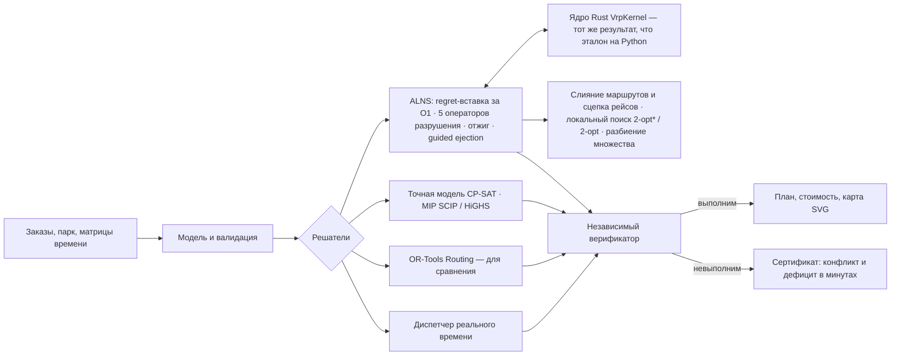

# SynAPS-MobiRoute

Движок маршрутизации для смешанного парка: VRPTW, PDPTW и DARP с вектором
ёмкости (кг, м³, паллеты), требованиями к машине, сменами, своими и наёмными
машинами, режимом труда и отдыха водителей, несколькими рейсами за смену и
пробками по часам суток. ALNS на ядре Rust и локальный поиск, точные модели
CP-SAT и MIP, сравнение с OR-Tools, диспетчеризация заявок в реальном времени —
и независимая проверка каждого плана.

Язык: **RU** | [EN](README.en.md) · Сайт: [konkovdv.github.io/SynAPS-MobiRoute](https://konkovdv.github.io/SynAPS-MobiRoute/)

[](https://github.com/KonkovDV/SynAPS-MobiRoute/actions/workflows/ci.yml)
[](https://www.python.org/)
[](native/mobiroute_native)
[](docs/benchmarks)
[](https://mypy-lang.org/)
[](https://github.com/astral-sh/ruff)
[](LICENSE)

Любой план — от эвристики, точной модели или OR-Tools — проходит отдельный
верификатор: загрузка, расписание и стоимость пересчитываются заново, решателю
ничего не доверяется. Если рейс невозможен, вы получаете не «infeasible», а
**сертификат**: какие ограничения конфликтуют и **сколько минут не хватает**.


## Результаты

| Что проверяем | Результат | Как воспроизвести |
| --- | --- | --- |
| 130 открытых эталонов: Solomon (VRPTW), Li & Lim и Sartori–Buriol (PDPTW, реальные дорожные времена OSRM), Cordeau (DARP) | все 130 планов проверены и обслуживают все заказы. Solomon: **56 из 56** — с числом машин лучшего известного решения, медиана разрыва 0.50%, 20 совпадений, худший случай 7.0%. Sartori–Buriol: 22 из 25, медиана 0.92%. Cordeau: 19 из 48 — опубликованный оптимум, средний разрыв 0.50% | `python benchmark/vrp_benchmark.py` → [таблица](docs/benchmarks/vrp-public-benchmarks.md) |
| ALNS против доказанного оптимума | CP-SAT доказал оптимум на 40 из 40 случайных задач полной модели (2–3 типа машин, вектор ёмкости, навыки, лимит поездки, смены); ALNS находит его в **40 из 40** за 0.15 с (CP-SAT — 1.1 с). Два прежних промаха закрыл оператор слияния маршрутов на машину другого типа | `python benchmark/exact_vs_alns.py` → [таблица](docs/benchmarks/exact-vs-alns.md) |
| OR-Tools Routing (PCI + GLS) при равном времени | 18 задач, по 10 с каждому, один верификатор: ALNS не хуже нигде. RC201: +0.79% против +7.81%; bar-n100-1 (дороги OSRM) +0.14% против +8.61%; на RC101, ber-, nyc-, poa-n100-1 — на 1–2 машины меньше; на a2-16 OR-Tools теряет заказ; грузовые дни со смешанным парком дешевле на **17–18%** и на две машины меньше | `python benchmark/ortools_vs_alns.py` → [таблица](docs/benchmarks/ortools-vs-alns.md) |
| Заявки в реальном времени | ответ на заявку в среднем за **0.1 мс** (95% — не дольше 0.22 мс): вставка в непроеханную часть плана; ALNS раз в 30 минут снижает стоимость (завод, 140 перевозок: −1.2%). Полный пересчёт OR-Tools на каждую заявку (3 с) принимает 86.4% против 83.6% и дешевле ещё на 1.6%, но отвечает за 2.9 с — в десятки тысяч раз дольше — и подаёт машину в среднем на 5 минут позже. Все итоговые планы проверены | `python benchmark/realtime_dispatch.py --with-ortools` → [таблица](docs/benchmarks/realtime-dispatch.md) |
| Профилирование → ядро на Rust | ALNS с ядром на Rust быстрее эталона на Python в **10–49 раз** (VRPTW ×10, PDPTW ×17, DARP ×49) — при **бит-в-бит одинаковом** результате, в том числе с перерывами и рейсами; на дне с 8 типами машин ×5.4: узким местом стали операторы на Python (подбор типов, слияние) | `python benchmark/measure_vrp_speed.py` → [таблица](docs/benchmarks/vrp-speed.md) |
| Выбор MIP/CP-решателя, Cordeau a2-16 | CP-SAT доказывает оптимум 294.25 за 0.7 с; SCIP — 26.2 с, HiGHS — 41.3 с; CBC за 60 с — разрыв 20%; LP-релаксация 85.27 (слабость big-M). ALNS находит тот же оптимум за 3.0 с; OR-Tools за 10 с теряет одну заявку из 16 |
| Выбор решателя для разбиения множества | одна модель set partitioning на пулах маршрутов ALNS, 7 задач, по 10 с: на R101/RC101 SCIP, HiGHS, CBC и CP-SAT в 8 потоков доказывают оптимум по пулу за 0.1–0.4 с; CP-SAT в одном потоке со штатными настройками не успевает за 10 с, а с `linearization_level=2` — за 0.1–0.2 с (теперь это настройка движка); на дне с рейсами все четыре находят план на **0.29% лучше ALNS**; на пуле из 6339 маршрутов лучший — CP-SAT в 8 потоков (−0.05%), HiGHS без подсказки решения не находит, CBC выдаёт план на 22.6% хуже. LP-релаксация даёт нижнюю границу по пулу | `python benchmark/setpart_study.py` → [таблица](docs/benchmarks/setpart-solvers.md) |
| Режим труда и отдыха | план грузового дня, построенный без нормы 4,5 ч / 45 мин, на каждом из 5 дней содержит **4–6 маршрутов, где перерыв поставить некуда** (не хватает 94–209 мин суммарно); план с нормой выполним, дороже на 2.0–5.5% | `python benchmark/rules_study.py` → [таблица](docs/benchmarks/rules.md) |
| Несколько рейсов | склад → 60 магазинов, две волны доставки: при одном рейсе на машину даже 21 машина (12 наёмных) обслуживает только 52–55 магазинов; при двух-трёх рейсах — **все 60 на 12–15 машинах** | то же |
| Пробки по часам суток | план на скоростях свободного потока в часы пик ломается на **8–13 маршрутах в день** (113–318 мин опозданий); план с учётом пробок выполним, дороже на 0–11% | то же |
| Статистика по зёрнам | 19 задач Solomon R2/RC2 × 5 зёрен: все прогоны — с эталонным числом машин, разброс разрыва по зёрнам до ±3 п. п. Локальный поиск сокращает план в 61 из 95 парных прогонов (медиана −0.32% от лучшего известного), критерий Уилкоксона **p = 0.006**; RC202 в среднем 8.3% → 6.3%, R211 6.5% → 3.9% | `python benchmark/seed_study.py` → [таблица](docs/benchmarks/seed-study.md) | `python benchmark/solver_lab.py` → [таблица](docs/benchmarks/solver-lab-a2-16.md) |
| Качество кода | 528 тестов, из них 6 свойств на Hypothesis (сотни случайных маршрутов: проверки поиска против независимого верификатора); `mypy --strict`, `ruff`, `clippy -D warnings`; Rust ↔ Python бит в бит | `pytest && ruff check . && mypy` |

Замеры — на одной машине (Linux x86_64, Python 3.13, один поток); это не SLA.

## Какие задачи решает

**Городская доставка со своим и наёмным парком.** Фургоны, грузовики, тягач;
у заказа вес, объём, паллеты, окно доставки, рефрижератор, гидроборт или
ДОПОГ. Решатель выпускает сначала свои машины и нанимает только тот класс,
которого не хватает.

**Распределительный центр с волнами доставки.** Утренние и дневные слоты
магазинов; машина возвращается на склад, перезагружается и уходит во второй
рейс. Смена, лимит вождения и окна проверяются на весь день, ёмкость — на
каждый рейс.

**Режим труда и отдыха и пробки.** Не больше 4,5 ч за рулём до перерыва 45
мин, не больше 9 ч вождения за смену; скорость по часам суток (часы пик).
Если перерыв поставить некуда, верификатор говорит, сколько минут не хватает.

**Внутризаводская логистика.** Перевозки паллет между цехами появляются в
течение смены. Каждая получает ответ за доли миллисекунды — вставку в
непроеханную часть плана или отказ с причиной (из прогона шаттла: «ближайшая
свободная машина доберётся до точки забора через 1.9 мин после закрытия
окна»). Раз в 30 минут живое состояние переоптимизируется.

**Шаттл по требованию.** Поездки между остановками: ожидание не больше 30
минут, ожидание плюс поездка — не больше 45; микроавтобусы на 8 мест.

**Пассажирская перевозка с особыми требованиями** (DARP): лимит времени в
пути, коляски, сопровождающие, водители с допуском — исходное ядро проекта
([docs/darp-kernel.md](docs/darp-kernel.md)).

## Как устроено



| Метод | Когда | Доказывает оптимум |
| --- | --- | --- |
| Regret-k вставка + ALNS (random, worst, Shaw, SISR, route; отжиг) | основной режим | нет |
| Guided ejection (Nagata & Bräysy) | сократить число машин | нет |
| Слияние двух маршрутов на машину другого типа; сцепка рейсов через перезагрузку | смешанный парк, несколько рейсов | нет |
| Локальный поиск relocate / swap / 2-opt* / 2-opt, окна за O(1) склейкой сегментов (Vidal et al. 2013) | VRPTW, каждый новый лучший план | нет |
| Разбиение множества по пулу маршрутов (CP-SAT, SCIP, HiGHS, CBC) | опция: перекомбинировать найденные маршруты | только по пулу |
| Вставка в живой план | новая заявка в течение дня | нет |
| CP-SAT, по циклу на машину | малые задачи с любыми ограничениями | да, для своей целочисленной модели |
| MIP Furtado–Munari–Morabito на SCIP / HiGHS / CBC | сравнение решателей, нижняя граница | да, по доказательству решателя |
| OR-Tools Routing (PCI + GLS) | эталон для сравнения | нет |
| Минимальное опоздание: бисекция по Беллману–Форду, LP | когда окна нельзя выполнить | да (LP) |

Проверка вставки за O(1): самое раннее и самое позднее начало обслуживания на
каждой остановке, загрузка по каждому измерению, а кратчайшая длительность
рейса после вставки — по формуле из префиксных и суффиксных экстремумов.
Перерыв водителя в промежутке между двумя обслуживаниями удлиняет одно
ограничение переезда — расписание остаётся системой разностных ограничений, и
проверка с сертификатами работает как прежде. При пробках функция прибытия
монотонна (FIFO), поэтому самое раннее расписание остаётся лучшим для окон.
Леммы и доказательства: [docs/mathematical-formulation.md](docs/mathematical-formulation.md).

## «Почему нельзя?» — сертификат

Грузовой день: перевозка от поставщика к клиенту.

```text
Рейс невозможен при любом расписании: не хватает 8.8 мин.
поставщик: начало не раньше 09:00 (погрузка 26 мин);
переезд поставщик → клиент: 162.8 мин;
клиент: начало разгрузки не позже 12:00.
```

Проверка вручную: 540 + 26 + 162.8 − 720 = 8.8. Сертификат — отрицательный цикл
в графе разностных ограничений; его вес и есть дефицит. Логист сразу видит, что
менять: окно клиента или время у поставщика.


## Быстрый старт

```bash
python -m pip install -e ".[dev]"
python -m pip install maturin
python -m maturin develop --release --manifest-path native/mobiroute_native/Cargo.toml
```

```bash
mobiroute vrp-solve --generate cargo --orders 120 --out-dir out-cargo --svg
mobiroute vrp-solve --instance benchmark/instances/sartori-buriol/n100/bar-n100-1.txt --time-limit 10 --out-dir out-sb --svg
mobiroute vrp-solve --generate cargo --orders 60 --solver ortools --time-limit 10 --out-dir out-ortools
mobiroute vrp-dispatch --day plant --policy insertion+alns --out-dir out-plant
mobiroute literature-benchmark --instance benchmark/instances/cordeau/a2-16.txt --out-dir out-a2 --svg
pytest            # быстрый набор; точные MIP-доказательства: pytest -m slow
```

```python
from mobiroute.vrp import AlnsConfig, load_benchmark, solve

inst, sha256 = load_benchmark("benchmark/instances/solomon/R101.txt")
result = solve(inst, AlnsConfig(time_limit=10, seed=1))
print(result.verdict.summary())
```

Без собранного ядра на Rust движок работает на эталонной реализации Python —
с тем же результатом, только медленнее.

## Документация

| Документ | О чём |
| --- | --- |
| [docs/cargo-vrp.md](docs/cargo-vrp.md) | грузовой VRP: модель, алгоритмы, сценарии, что дальше |
| [docs/mathematical-formulation.md](docs/mathematical-formulation.md) | постановка, вставка за O(1), разностные ограничения, перерывы, рейсы, пробки (леммы с доказательствами), локальный поиск, разбиение множества, LP опоздания, CP-SAT, MIP, статистика сравнений |
| [docs/architecture.md](docs/architecture.md) | модули, потоки данных, проектные решения |
| [docs/native-acceleration.md](docs/native-acceleration.md) | профилирование и ядра на Rust |
| [docs/benchmark-protocol.md](docs/benchmark-protocol.md) | правила публикации чисел |
| [docs/benchmarks/](docs/benchmarks) | таблицы всех экспериментов |
| [docs/darp-kernel.md](docs/darp-kernel.md) | пассажирское ядро DARP: правила, диспетчеризация, проверки |
| [docs/limitations.md](docs/limitations.md) | чего движок пока не умеет |
| [benchmark/instances/README.md](benchmark/instances/README.md) | происхождение эталонов и ссылки |

## Границы применимости

Открытые эталоны и синтетические дни; данных заказчика и пилота нет. Перерыв —
один за смену; пробки — один профиль скорости на всю сеть и только на
эталоне Python; OR-Tools, точная модель и живой диспетчер этих правил не
моделируют и отклоняют такие задачи явной ошибкой. Эвристики оптимум не
доказывают — разрыв к лучшим решениям опубликован по каждому инстансу, разброс
по зёрнам измерен. Подробно: [docs/limitations.md](docs/limitations.md).

## Лицензия

MIT — см. [LICENSE](LICENSE). Цитирование — [CITATION.cff](CITATION.cff).
