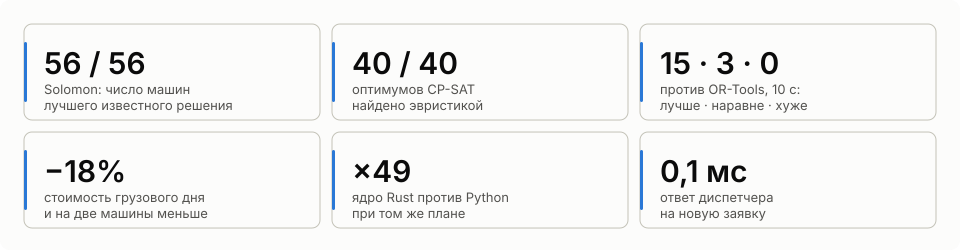
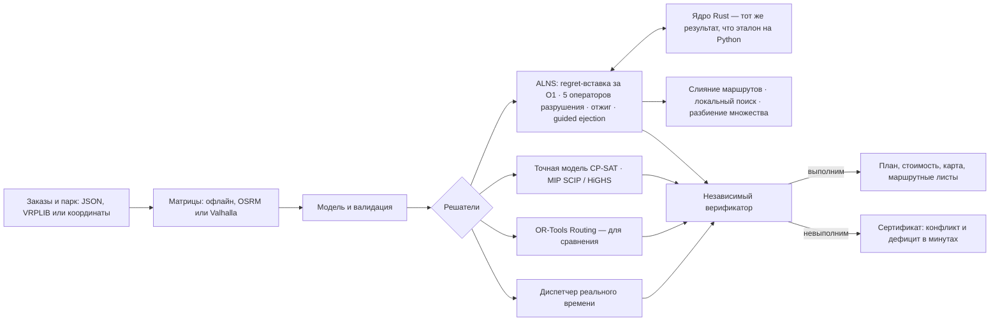
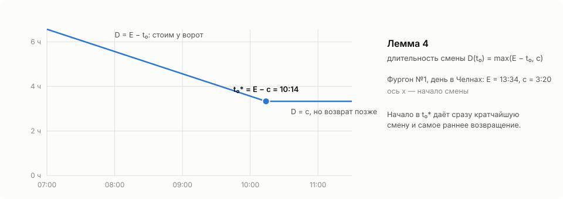
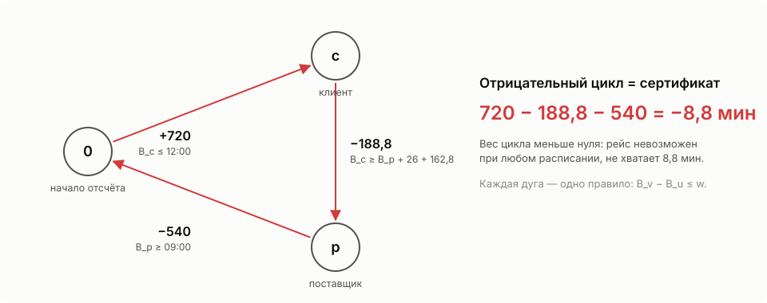

# SynAPS-MobiRoute

**Маршруты для смешанного грузового парка, которые можно проверить.**
VRPTW, PDPTW и DARP с вектором ёмкости, своими и наёмными машинами, режимом
труда и отдыха водителей, несколькими рейсами за смену, пробками и зонами
запрета для грузовиков. ALNS на ядре Rust, точные модели CP-SAT и MIP,
независимый верификатор каждого плана и маршрутные листы для водителей.

Язык: **RU** | [EN](README.en.md) · Сайт: [konkovdv.github.io/SynAPS-MobiRoute](https://konkovdv.github.io/SynAPS-MobiRoute/)

[](https://github.com/KonkovDV/SynAPS-MobiRoute/actions/workflows/ci.yml)
[](https://www.python.org/)
[](native/mobiroute_native)
[](docs/benchmarks)
[](https://mypy-lang.org/)
[](https://github.com/astral-sh/ruff)
[](LICENSE)

> **Коротко.** Открытый движок строит маршруты для парка грузовиков и
> фургонов, своих и наёмных: окна доставки, вес, объём и паллеты, режим труда
> и отдыха водителей (включая перерыв 15 + 30 мин), несколько рейсов за
> смену, зоны запрета для тяжёлых машин. Каждый план проверяет независимая
> программа, на выходе — маршрутный лист для водителя. При равном времени
> план лучше, чем у Google OR-Tools, на 15 задачах из 18 и не хуже на
> остальных; грузовой день — на 17–18% дешевле и на две машины меньше.
> Python и Rust, 590 тестов, документация на русском и английском.
> Автор — Дмитрий Коньков ([GitHub](https://github.com/KonkovDV)).


## Ключевые результаты



| | Результат | Таблица |
| --- | --- | --- |
| Открытые эталоны | 130 задач, все планы проверены. Solomon: **56 из 56** с числом машин лучшего известного решения, медиана разрыва 0,50%. Cordeau: 19 из 48 — опубликованный оптимум | [vrp-public-benchmarks](docs/benchmarks/vrp-public-benchmarks.md) |
| Доказанный оптимум | ALNS находит оптимум, доказанный CP-SAT, в **40 из 40** задач полной модели за 0,15 с | [exact-vs-alns](docs/benchmarks/exact-vs-alns.md) |
| Против OR-Tools | 18 задач, по 10 с: лучше на **15**, наравне на 3, хуже — ни на одной; грузовые дни **−17…18%** стоимости и на две машины меньше | [ortools-vs-alns](docs/benchmarks/ortools-vs-alns.md) |
| 1000 клиентов | после профилирования **в 2,9 раза больше** итераций в минуту; Gehring–Homberger C1_10_1 — разрыв 0,01% за 12 с | [CHANGELOG](CHANGELOG.md) |
| Ядро на Rust | быстрее эталона на Python: VRPTW **×10**, PDPTW **×17**, DARP **×49**, грузовой день ×5,4 — при бит-в-бит одинаковом результате | [vrp-speed](docs/benchmarks/vrp-speed.md) |
| Заявки в реальном времени | ответ за **0,1 мс** (95% — до 0,22 мс), подача машины на 5 минут раньше, чем при пересчёте OR-Tools | [realtime-dispatch](docs/benchmarks/realtime-dispatch.md) |
| Правила эксплуатации | без нормы 4,5 ч / 45 мин в плане **4–6 маршрутов в день** без места для перерыва; два рейса обслуживают **60 из 60** магазинов вместо 52–55; учёт часов пик спасает **8–13 маршрутов** от опозданий | [rules](docs/benchmarks/rules.md) |
| Статистика | 19 задач × 5 зёрен, все на эталонном числе машин; эффект локального поиска значим, **p = 0,006** (Уилкоксон) | [seed-study](docs/benchmarks/seed-study.md) |

Замеры: Linux x86_64, Python 3.13, один поток. Каждое число воспроизводится
скриптом из `benchmark/`.

## Задачи вакансии → где это в репозитории

| Задача | Что сделано | Где проверить |
| --- | --- | --- |
| VRP с окнами, забором и доставкой, разнородным парком | одна модель для VRPTW, PDPTW и DARP: вектор ёмкости, навыки, смены, свои и наёмные машины, режим труда и отдыха, несколько рейсов, пробки, зоны для грузовиков | [модель](src/mobiroute/vrp/model.py) · [эталоны](docs/benchmarks/vrp-public-benchmarks.md) |
| Выбор MIP/CP-решателя | одна модель на CP-SAT, SCIP, HiGHS и CBC с LP-границей; решатель выбирается замером на своём классе задач | [Cordeau a2-16](docs/benchmarks/solver-lab-a2-16.md) · [разбиение множества](docs/benchmarks/setpart-solvers.md) |
| Эвристики и метаэвристики | regret-k, ALNS с отжигом, guided ejection, слияние маршрутов, локальный поиск с окнами за O(1), гранулярный режим для 1000+ клиентов | [40 из 40](docs/benchmarks/exact-vs-alns.md) · [OR-Tools](docs/benchmarks/ortools-vs-alns.md) |
| LP/IP, графы, комбинаторная оптимизация | разностные ограничения и Беллман–Форд с сертификатами, поток минимальной стоимости, set partitioning, пять лемм с доказательствами | [постановка](docs/mathematical-formulation.md) · [ниже](#математика-на-одном-экране) |
| Продуктовый код | CLI, ввод в координатах, матрицы OSRM и Valhalla, VRPLIB, маршрутные листы CSV / Markdown / SVG, коды ошибок, ядро на Rust | [маршрутные листы](#из-координат--в-маршрутные-листы) |
| Python: ООП, тесты, профилирование | неизменяемые модели, `mypy --strict`, 590 тестов (10 свойств Hypothesis), мутационная проверка, профилирование → ускорение в 2,9 раза | [тесты](tests) · [ускорение](docs/native-acceleration.md) |
| Ревью кода и документация | правила ревью, CI (ruff, mypy, clippy, тесты, прогоны CLI), документация на двух языках, журнал изменений | [CONTRIBUTING](CONTRIBUTING.md) · [архитектура](docs/architecture.md) |
| Данные заказчика | открытые эталоны, в том числе на реальных дорожных временах OSRM и на 1000 клиентов; данные перевозчика входят координатами и матрицами его маршрутизатора | [область применения](docs/limitations.md) · [практика РФ](docs/trucking-ru.md) |

## Что умеет

**Модель.** Окна на заборе и доставке; пары «забор → доставка», доставка со
склада и сбор на склад; вес, объём, паллеты и любые другие измерения;
рефрижератор, гидроборт, ДОПОГ как навыки; типы машин со своей ёмкостью,
скоростью, сменой и ценой; плата за выход наёмной машины.

**Правила.** Перерыв не позже 4,5 ч вождения и не больше 9 ч за смену, в
том числе разделённый 15 + 30 мин (приказ Минтранса № 424, регламент ЕС
561/2006); несколько рейсов с повторной загрузкой на складе; пробки по часам
суток; зоны, закрытые для машин тяжелее, выше или с большей нагрузкой на ось
(знаки 3.4, 3.11–3.13); оплата всей смены вместе с ожиданием.

**Решатели.** ALNS с ядром на Rust, точные модели CP-SAT и MIP для
доказательства оптимума, разбиение множества по пулу маршрутов, OR-Tools для
сравнения, диспетчер заявок в реальном времени.

**Результат.** План, стоимость, карта, маршрутные листы (CSV, Markdown,
диаграмма Ганта) — или сертификат: какие ограничения конфликтуют и сколько
минут не хватает.

## Сравнение с аналогами

Возможности сверены по документации проектов (14.11.2026); подробности,
источники и научные публикации — в [docs/comparison.md](docs/comparison.md).

| | Этот движок | OR-Tools | VROOM | PyVRP | jsprit | Яндекс Маршрутизация |
| --- | :---: | :---: | :---: | :---: | :---: | :---: |
| Окна, забор и доставка, разнородный парк | ✓ | ✓ | ✓ | ✓ | ✓ | ◐ |
| Несколько рейсов за смену | ✓ | ◐ вручную | н/д | ✓ | н/д | ✓ |
| Перерыв по времени за рулём, 15 + 30 | ✓ | ◐ интервалы | ◐ окна | Enterprise | н/д | н/д |
| Зоны для грузовиков, грузовые матрицы | ✓ | — | ◐ профиль | — | н/д | н/д |
| Пробки по времени суток | ✓ | н/д | н/д | н/д | ✓ | ✓ |
| Доказанный оптимум на той же модели | ✓ | — | — | — | — | н/д |
| Независимая проверка и сертификат | ✓ | н/д | н/д | н/д | н/д | н/д |
| Открытый код | MIT | Apache-2.0 | BSD-2 | MIT | Apache-2.0 | — |

◐ — частично, н/д — не нашли в документации. Для классических CVRP/VRPTW без
правил парка хороши PyVRP и VROOM, для готового интерфейса логиста —
коммерческий сервис; этот движок — когда нужна своя модель с режимом труда и
отдыха, рейсами, разнородным парком и проверяемым результатом.

## Как устроено



| Метод | Когда | Доказывает оптимум |
| --- | --- | --- |
| Regret-k вставка + ALNS (random, worst, Shaw, SISR, route; отжиг) | основной режим | нет |
| Guided ejection (Nagata & Bräysy 2009) | сократить число машин | нет |
| Слияние маршрутов на машину другого типа, сцепка рейсов | смешанный парк, несколько рейсов | нет |
| Локальный поиск relocate / swap / 2-opt* / 2-opt, окна за O(1) (Vidal et al. 2013) | каждый новый лучший план | нет |
| Разбиение множества по пулу маршрутов (CP-SAT, SCIP, HiGHS, CBC) | перекомбинировать найденные маршруты | по пулу |
| CP-SAT, по циклу на машину | малые задачи с любыми ограничениями | да |
| MIP Furtado–Munari–Morabito на SCIP / HiGHS / CBC | нижняя граница, сравнение решателей | да |
| Минимальное опоздание: бисекция по Беллману–Форду, LP | когда окна нельзя выполнить | да (LP) |

## Математика на одном экране

**Цель — деньги, а не километры.** Плата за выход $f_k$ (у своей машины 0),
цена километра $c^d_k$ и часа $c^t_k$ типа машины $k$, штраф $\pi_r$ за
необслуженный заказ:

```math
\min \sum_{\text{маршруты}} \Big( f_k + c^d_k \sum d_{ij} + c^t_k \big(\textstyle\sum t_{ij} + \sum s_i\big) \Big) \;+\; \sum_{r\ \text{не обслужен}} \pi_r
```

**Расписание — система разностных ограничений.** Для фиксированного порядка
остановок каждое правило — неравенство $B_v - B_u \le w_{uv}$ на начала
обслуживания:

```math
e_i \le B_i \le l_i, \qquad
B_{i+1} \ge B_i + s_i + t_{i,i+1} \;(+\,b \text{ в промежутке с перерывом}), \qquad
B_{d_r} - B_{p_r} - s_{p_r} \le L_r, \qquad
B_{\text{end}} - B_{\text{start}} \le T_k
```

Система совместна тогда и только тогда, когда в графе ограничений нет
отрицательного цикла. Беллман–Форд его находит, и цикл $C$ становится
сертификатом: $-\sum_{C} w$ — сколько минут не хватает.

**Вставка за O(1)** (Savelsbergh 1992). Прямой и обратный проход

```math
\mathrm{begin}_k = \max\big(\mathrm{begin}_{k-1} + s_{k-1} + t_{k-1,k},\; e_k\big), \qquad
\mathrm{late}_k = \min\big(l_k,\; \mathrm{late}_{k+1} - s_k - t_{k,k+1}\big)
```

решают за константу, встаёт ли заказ $u$ между $v_i$ и $v_{i+1}$:
$b_u = \max(\mathrm{begin}_i + s_i + t_{iu},\, e_u) \le l_u$ и
$b_u + s_u + t_{u,i+1} \le \mathrm{late}_{i+1}$.

**Тип машины для готовых маршрутов — транспортная задача.** Маршрут $\rho$
на типе $k$ стоит $\mathrm{cost}_k(\rho)$:

```math
\min \sum_{\rho, k} \mathrm{cost}_k(\rho)\, z_{\rho k}
\quad \text{при} \quad \sum_k z_{\rho k} = 1, \qquad \sum_\rho z_{\rho k} \le n_k, \qquad z \ge 0
```

Матрица ограничений вполне унимодулярна, поэтому LP-решение целочисленно, и
задача решается потоком минимальной стоимости.

**Разбиение множества по пулу маршрутов** $\Omega$:

```math
\min \sum_{\rho \in \Omega} c_\rho x_\rho + \sum_r \pi_r y_r
\quad \text{при} \quad \sum_{\rho \ni r} x_\rho + y_r = 1 \;\; \forall r, \qquad
\sum_{\rho \in \Omega_k} x_\rho \le n_k, \qquad x \in \{0, 1\}^{\Omega}
```

**Когда начинать смену (лемма 4).** Пусть $E$ — самое раннее возвращение,
$c$ — кратчайшая смена, $U_0$ — самое позднее начало. При начале в
$t_0 \le U_0$ смена длится

```math
D(t_0) = \max\big(E - t_0,\; c\big), \qquad t_0^{*} = E - c .
```

Начало в $t_0^{*}$ даёт сразу и кратчайшую смену, и самое раннее
возвращение: на синтетическом дне в Челнах это 14,8 ч времени смены в день
при тех же маршрутах. На [сайте](https://konkovdv.github.io/SynAPS-MobiRoute/#sheets)
график $D(t_0)$ можно двигать руками. Перерыв, разделённый на 15 + 30 мин,
укладывается в ту же систему двумя удлинёнными дугами (лемма 1a).


Доказательства — в [docs/mathematical-formulation.md](docs/mathematical-formulation.md).

## «Почему нельзя?» — сертификат



Грузовой день: перевозка от поставщика к клиенту.

```text
Рейс невозможен при любом расписании: не хватает 8.8 мин.
поставщик: начало не раньше 09:00 (погрузка 26 мин);
переезд поставщик → клиент: 162.8 мин;
клиент: начало разгрузки не позже 12:00.
```

Проверка вручную: 540 + 26 + 162,8 − 720 = 8,8. Сертификат — отрицательный
цикл в графе разностных ограничений; его вес и есть дефицит. Логист сразу
видит, что менять: окно клиента или время у поставщика.


## Из координат — в маршрутные листы

Заказы и парк задаются так, как их выгружает учётная система: склад с часами
работы и временем погрузки, заказ с окном «08:00–11:00», погрузка на складе
или у поставщика, вес, объём и паллеты, требования к машине; типы машин со
сменой, ценой километра и часа, массой и высотой, нормой отдыха и числом
рейсов; зоны запрета для грузовиков. Формат описан в
[docs/cargo-vrp.md](docs/cargo-vrp.md#данные-из-координат-и-маршрутные-листы).
Матрицы времени и расстояний — офлайн, с сервера [OSRM](https://project-osrm.org/)
или с [Valhalla](https://github.com/valhalla/valhalla) с грузовым профилем
(масса, высота, нагрузка на ось, опасный груз).

```bash
mobiroute vrp-solve --geo examples/chelny-day.geo.json --sheets --out-dir out-chelny
mobiroute vrp-solve --geo examples/chelny-day.geo.json --valhalla http://localhost:8002 --sheets --out-dir out-trucks
```

На каждую машину — маршрутный лист: `route-sheets.md` для людей,
`route-sheets.csv` для учётной системы, `route-sheets.svg` — диаграмма Ганта
дня. В листе прибытие, начало и конец работ на каждой точке, загрузка по
каждому измерению, повторная загрузка между рейсами, перерыв водителя,
порядок загрузки кузова и проверка режима труда и отдыха. Машина выезжает так
поздно, как позволяет самое раннее возвращение, и не стоит час у ворот
первого клиента.


```text
## van #1 · своя · 2 рейса
Начало 10:14, выезд 10:34, возврат 13:34; 36,3 км, за рулём 73 мин, ожидание 0 мин; стоимость 1 999 ₽
Режим труда и отдыха соблюдён: непрерывно за рулём 1:13 / 4:30; за рулём за смену 1:13 / 9:00; смена 3:20 / 10:00.
Порядок загрузки на складе, обратный порядку выгрузки: рейс 1: Z011, Z020, Z014; рейс 2: Z027, Z002.

| Рейс | Что                | Заказ | Где                 | Окно        | Прибытие | Начало | Конец |     kg |
| ---: | ------------------ | ----- | ------------------- | ----------- | -------: | -----: | ----: | -----: |
|    1 | загрузка и выезд   |       | Склад (условн.)     |             |    10:14 |  10:14 | 10:34 | 1427,4 |
|    1 | выгрузка           | Z014  | Клиент 14 (условн.) | 08:00-11:00 |    10:37 |  10:37 | 10:55 |  645,8 |
|    1 | выгрузка           | Z020  | Клиент 20 (условн.) | 11:00-14:00 |    11:00 |  11:00 | 11:14 |  371,1 |
|    1 | выгрузка           | Z011  | Клиент 11 (условн.) | 08:00-18:00 |    11:16 |  11:16 | 11:30 |      0 |
|    2 | загрузка на складе |       | Склад (условн.)     | 07:00-20:00 |    11:36 |  11:36 | 12:01 | 1329,1 |
|    2 | выгрузка           | Z002  | Клиент 2 (условн.)  | 11:00-14:00 |    12:27 |  12:27 | 12:49 |  241,1 |
|    2 | выгрузка           | Z027  | Клиент 27 (условн.) | 08:00-18:00 |    13:04 |  13:04 | 13:18 |      0 |
|    2 | возврат            |       | Склад (условн.)     |             |    13:34 |  13:34 | 13:34 |      0 |
```

Пример — синтетический день в Набережных Челнах: склад, три поставщика, 45
заказов, свои и наёмные фургоны и грузовики; точки случайны в границах
города, названия условные ([генератор](examples/make_chelny_day.py)). ALNS
закрывает день за 2,2 с семью машинами: все четыре своих фургона идут в два
рейса, из наёмных нужен один грузовик.

> Маршрутный лист — план рейса для водителя. Путевой лист (ст. 6 Устава
> автомобильного транспорта, приказ Минтранса № 390) с отметками о
> медосмотре, техконтроле и одометре ведёт учётная система; CSV загружается в
> неё как задание.

## Быстрый старт

```bash
python -m pip install -e ".[dev]"
python -m pip install maturin
python -m maturin develop --release --manifest-path native/mobiroute_native/Cargo.toml
```

```bash
mobiroute vrp-solve --generate cargo --orders 120 --out-dir out-cargo --svg
mobiroute vrp-solve --geo examples/chelny-day.geo.json --sheets --out-dir out-chelny
mobiroute vrp-solve --instance benchmark/instances/gehring-homberger/C1_10_1.vrp --time-limit 60 --out-dir out-c1
mobiroute vrp-solve --generate cargo --orders 60 --solver ortools --time-limit 10 --out-dir out-ortools
mobiroute vrp-dispatch --day plant --policy insertion+alns --out-dir out-plant
mobiroute literature-benchmark --instance benchmark/instances/cordeau/a2-16.txt --out-dir out-a2 --svg
pytest            # быстрый набор; точные MIP-доказательства: pytest -m slow
```

```python
from mobiroute.vrp import AlnsConfig, geo, load_benchmark, route_sheets, sheets_markdown, solve

inst, sha256 = load_benchmark("benchmark/instances/solomon/R101.txt")
result = solve(inst, AlnsConfig(time_limit=10, seed=1))
print(result.verdict.summary())

day = geo.load("examples/chelny-day.geo.json")  # или osrm=..., valhalla=...
plan = solve(day.instance, AlnsConfig(time_limit=10, seed=1))
sheets = route_sheets(day.instance, plan.solution, plan.verdict, day.places)
print(sheets_markdown(sheets, day.instance.dimensions, currency=day.currency))
```

Без собранного ядра на Rust движок работает на эталонной реализации Python с
тем же результатом.

## Документация

| Документ | О чём |
| --- | --- |
| [docs/cargo-vrp.md](docs/cargo-vrp.md) | грузовой VRP: модель, алгоритмы, ввод в координатах, маршрутные листы, сценарии |
| [docs/trucking-ru.md](docs/trucking-ru.md) | российская практика грузоперевозок: режим труда и отдыха, путевой лист, знаки и зоны, «Платон», ДОПОГ — и как каждое правило задаётся в модели |
| [docs/mathematical-formulation.md](docs/mathematical-formulation.md) | постановка, вставка за O(1), разностные ограничения, перерывы, рейсы, пробки, расписание для водителя — леммы с доказательствами |
| [docs/comparison.md](docs/comparison.md) | сравнение с OR-Tools, VROOM, PyVRP, jsprit, Timefold и Яндекс Маршрутизацией; публикации и что из них взято в движок |
| [docs/architecture.md](docs/architecture.md) | модули, потоки данных, проектные решения |
| [docs/native-acceleration.md](docs/native-acceleration.md) | профилирование и ядро на Rust |
| [docs/benchmark-protocol.md](docs/benchmark-protocol.md) | правила публикации чисел |
| [docs/benchmarks/](docs/benchmarks) | таблицы всех экспериментов |
| [docs/darp-kernel.md](docs/darp-kernel.md) | пассажирское ядро DARP |
| [docs/limitations.md](docs/limitations.md) | область применения и развитие |
| [benchmark/instances/README.md](benchmark/instances/README.md) | происхождение эталонов |
| [CHANGELOG.md](CHANGELOG.md) | журнал изменений |

## Область применения и развитие

Движок проверен на открытых эталонах — в том числе на реальных дорожных
временах OSRM и на задачах в 1000 клиентов — и на синтетических днях. Данные
перевозчика входят координатами и матрицами его маршрутизатора (OSRM или
Valhalla с грузовым профилем). Разрыв к лучшим известным решениям опубликован
по каждой задаче, разброс по зёрнам измерен, оптимум малых задач доказан
точными моделями. Дальше — запрет въезда по времени суток, многодневные рейсы
с суточным отдыхом, разделённый перерыв и пробки в ядре Rust
([подробнее](docs/limitations.md)).

## Лицензия

MIT — см. [LICENSE](LICENSE). Цитирование — [CITATION.cff](CITATION.cff).
