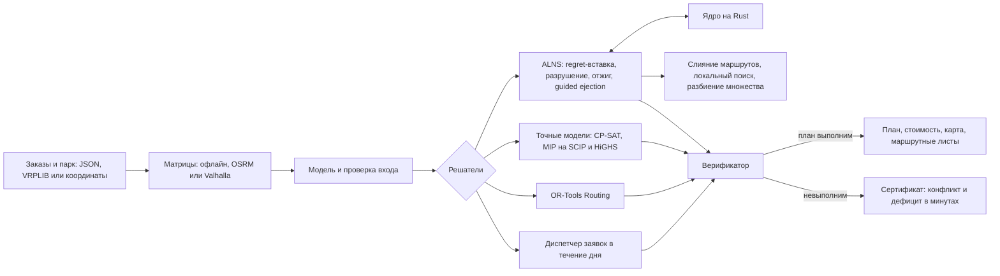

# SynAPS-MobiRoute

Движок для задач маршрутизации транспорта со смешанным парком. VRPTW, PDPTW и
DARP решаются в одной модели: окна на погрузке и выгрузке, пары «забор —
доставка», груз с весом, объёмом и паллетами, свои и наёмные машины разных
типов, режим труда и отдыха водителей, несколько рейсов за смену, скорость по
часам суток.

Основной метод — ALNS. Его горячая часть (вставка заказов и проверка
расписания) переписана на Rust и даёт ровно те же планы, что эталонная
реализация на Python. Малые задачи решаются точно моделями CP-SAT и MIP
(SCIP, HiGHS, CBC), для сравнения подключён OR-Tools Routing. Любой план,
откуда бы он ни пришёл, пересчитывает отдельный верификатор. Если рейс
выполнить нельзя, верификатор показывает, какие ограничения друг другу
мешают и сколько минут не хватает.

[English version](README.en.md) · [Сайт с интерактивными примерами](https://konkovdv.github.io/SynAPS-MobiRoute/)

[](https://github.com/KonkovDV/SynAPS-MobiRoute/actions/workflows/ci.yml)
[](https://www.python.org/)
[](native/mobiroute_native)
[](LICENSE)


## Быстрый старт

```bash
python -m pip install -e ".[dev]"
python -m pip install maturin
python -m maturin develop --release --manifest-path native/mobiroute_native/Cargo.toml
```

Ядро на Rust можно не собирать: без него те же планы считает Python, только
медленнее.

```bash
# грузовой день: 120 заказов, свои и наёмные машины, карта маршрутов в SVG
mobiroute vrp-solve --generate cargo --orders 120 --out-dir out-cargo --svg

# день в координатах -> маршрутные листы (CSV, Markdown, диаграмма Ганта)
mobiroute vrp-solve --geo examples/chelny-day.geo.json --sheets --out-dir out-chelny

# эталон Cordeau a2-16: точная модель CP-SAT и проверка плана
mobiroute literature-benchmark --instance benchmark/instances/cordeau/a2-16.txt --out-dir out-a2 --svg

pytest          # быстрый набор тестов; точные MIP-модели: pytest -m slow
```

Из Python:

```python
from mobiroute.vrp import AlnsConfig, load_benchmark, solve

inst, sha256 = load_benchmark("benchmark/instances/solomon/R101.txt")
result = solve(inst, AlnsConfig(time_limit=10, seed=1))
print(result.verdict.summary())
```

## Модель

Заказ — это пара «забор — доставка», доставка со склада или сбор на склад. Спрос
задаётся вектором любой длины (кг, м³, паллеты), требования к машине — набором
навыков: рефрижератор, гидроборт, допуск ДОПОГ. Тип машины описывает
количество машин, ёмкость, склад, смену, профиль скорости, плату за выход, цену
километра и часа. Наёмный тип отличается от своего только ценой, поэтому
решатель сам нанимает машины того класса, которого не хватает. Целевая
функция считает деньги: плату за выход, пробег, время и штрафы за
необслуженные заказы.

Правила эксплуатации входят в модель как ограничения, а не как поправки после
решения:

- перерыв 45 минут не позже чем через 4,5 часа за рулём и не больше 9 часов
  вождения за смену, в том числе перерыв, разделённый на 15 и 30 минут
  (приказ Минтранса № 424, регламент ЕС 561/2006);
- несколько рейсов за смену с повторной загрузкой на складе;
- скорость по часам суток (модель Ichoua, Gendreau и Potvin со свойством FIFO);
- зоны, закрытые для машин по массе, нагрузке на ось, высоте или типу (знаки
  3.4, 3.11–3.13);
- лимит времени груза в пути и длительность смены.

Формальная постановка и доказательства — в
[docs/mathematical-formulation.md](docs/mathematical-formulation.md), грузовая
часть подробно — в [docs/cargo-vrp.md](docs/cargo-vrp.md).

## Алгоритмы

| Метод | Для чего | Доказывает оптимум |
| --- | --- | --- |
| Вставка regret-k с проверкой за O(1) и ALNS: случайное, худшее, Shaw, SISR и маршрутное разрушение, отжиг, адаптивные веса | основной поиск | нет |
| Guided ejection (Nagata, Bräysy 2009) | сократить число машин | нет |
| Перебор типов машин для готовых маршрутов как транспортная задача (поток минимальной стоимости) | смешанный парк | да, для заданных маршрутов |
| Слияние двух маршрутов на машину другого типа, сцепка рейсов через склад | смешанный парк, несколько рейсов | нет |
| Локальный поиск relocate, swap, 2-opt*, 2-opt со склейкой временных сегментов (Vidal и др. 2013) | каждый новый лучший план VRPTW | нет |
| Разбиение множества по пулу маршрутов (CP-SAT, SCIP, HiGHS, CBC) | перекомбинировать найденные маршруты | только по пулу |
| Двойственная задача LP-релаксации по пулу (GLOP) | цены заказов и рента типов машин | для LP |
| CP-SAT, по циклу на машину | малые задачи с любыми ограничениями модели | да |
| Компактная MIP Furtado, Munari, Morabito (2017) на SCIP, HiGHS, CBC | нижние границы, сравнение решателей | да |
| OR-Tools Routing (PARALLEL_CHEAPEST_INSERTION + GUIDED_LOCAL_SEARCH) | базовая линия для сравнения | нет |
| Вставка в непроеханную часть плана | заявки в течение дня | нет |

Решатель, который не поддерживает какое-то правило задачи (например, OR-Tools
и точная модель не знают про перерывы и рейсы), отказывается от такой задачи с
кодом ошибки и не возвращает план, молча нарушающий правило.

## Результаты

| Что измерялось | Результат | Таблица |
| --- | --- | --- |
| Cordeau a2-16, точные модели | CP-SAT доказывает опубликованный оптимум 294,25 меньше чем за секунду, SCIP — примерно за 26 с, HiGHS — за 40 с. CBC за 60 с оставляет разрыв 20%. LP-релаксация компактной модели даёт только 85,27: big-M слабый. ALNS приходит к тому же оптимуму примерно за 3 с | [solver-lab-a2-16](docs/benchmarks/solver-lab-a2-16.md) |
| 130 открытых эталонов | все планы прошли верификатор. Solomon: на всех 56 задачах число машин как у лучшего известного решения, медианный разрыв по расстоянию 0,50%, худший 7,0%. Cordeau: опубликованный оптимум на 19 задачах из 48, средний разрыв 0,50% | [vrp-public-benchmarks](docs/benchmarks/vrp-public-benchmarks.md) |
| ALNS против доказанного оптимума | 40 случайных задач полной модели (2–3 типа машин, вектор ёмкости, навыки, лимиты поездки, смены), оптимум доказан CP-SAT: ALNS находит его во всех 40. Когда заказом выгоднее пожертвовать, — в 87 задачах из 90 | [exact-vs-alns](docs/benchmarks/exact-vs-alns.md) |
| OR-Tools при равном времени | 18 задач по 10 с, оба плана проверяет один верификатор: ALNS лучше на 12, одинаково на 6, хуже ни на одной. Грузовые дни со смешанным парком на 14–17% дешевле и требуют на 1–3 машины меньше | [ortools-vs-alns](docs/benchmarks/ortools-vs-alns.md) |
| PyVRP, VROOM, jsprit | Solomon, где сначала считается число машин: число машин лучшего известного решения на 56 задачах из 56, у PyVRP на 50, у VROOM на 32, у jsprit на 30. На 1000 клиентов при оценке только по расстоянию впереди PyVRP: +1,2% к лучшему известному решению против +2,9% у этого движка | [solvers](docs/benchmarks/solvers.md) |
| Ядро на Rust | быстрее эталона на Python при тех же планах бит в бит: на VRPTW в 10 раз, на PDPTW в 17, на DARP с лимитами поездки в 49. На грузовом дне с восемью типами машин — в 5,4 раза: там узким местом стали операторы, которые пока остались на Python | [vrp-speed](docs/benchmarks/vrp-speed.md) |
| Профилирование | на задаче в 1000 клиентов правки по профилю `cProfile` дали в 2,9 раза больше итераций в минуту, разрыв к лучшему известному решению сократился с 5,75% до 3,4% | [native-acceleration](docs/native-acceleration.md) |
| Заявки в течение дня | ответ на новую заявку в среднем за 0,1 мс, 95% ответов быстрее 0,21 мс | [realtime-dispatch](docs/benchmarks/realtime-dispatch.md) |
| Правила эксплуатации | план, построенный без нормы 4,5 ч / 45 мин, оставляет 4–6 маршрутов в день, где перерыв поставить некуда. Два рейса закрывают 60 магазинов из 60, один — только 52–55. План на скоростях свободного потока в часы пик опаздывает на 8–13 маршрутах | [rules](docs/benchmarks/rules.md) |
| Разброс по зёрнам | 19 задач Solomon R2 и RC2 по 5 зёрен; эффект локального поиска значим по критерию Уилкоксона, p = 0,006 | [seed-study](docs/benchmarks/seed-study.md) |

Замеры сделаны на одной машине: Linux x86_64, Python 3.13, один поток. Каждую
таблицу пишет скрипт из `benchmark/` (команды — в
[benchmark/README.md](benchmark/README.md)). С теми же параметрами и зерном
повторный прогон даёт те же стоимости до сотых; время зависит от машины.

## Как устроено



### Где что лежит

| Что | Код |
| --- | --- |
| Модель задачи: заказы, типы машин, правила | [vrp/model.py](src/mobiroute/vrp/model.py) |
| Вставка с проверкой окон, ёмкости и смены за O(1) | [vrp/insertion.py](src/mobiroute/vrp/insertion.py), на Rust — [vrp.rs](native/mobiroute_native/src/vrp.rs) |
| ALNS и guided ejection | [vrp/alns.py](src/mobiroute/vrp/alns.py) |
| Локальный поиск, слияние маршрутов, выбор типов машин | [vrp/local_search.py](src/mobiroute/vrp/local_search.py), [vrp/merge.py](src/mobiroute/vrp/merge.py), [vrp/fleet.py](src/mobiroute/vrp/fleet.py) |
| Разбиение множества и двойственные цены | [vrp/setpart.py](src/mobiroute/vrp/setpart.py), [vrp/prices.py](src/mobiroute/vrp/prices.py) |
| Точные модели CP-SAT и MIP | [vrp/exact.py](src/mobiroute/vrp/exact.py), [benchmarks/cordeau_exact.py](src/mobiroute/benchmarks/cordeau_exact.py) |
| OR-Tools Routing на той же модели | [vrp/ortools_baseline.py](src/mobiroute/vrp/ortools_baseline.py) |
| Верификатор и расписание для водителя | [vrp/verify.py](src/mobiroute/vrp/verify.py), [vrp/schedule.py](src/mobiroute/vrp/schedule.py) |
| Перерывы, рейсы, пробки | [vrp/schedule.py](src/mobiroute/vrp/schedule.py), [vrp/traffic.py](src/mobiroute/vrp/traffic.py) |
| Заявки в течение дня | [vrp/realtime.py](src/mobiroute/vrp/realtime.py) |
| Ввод в координатах, маршрутные листы | [vrp/geo.py](src/mobiroute/vrp/geo.py), [vrp/sheets.py](src/mobiroute/vrp/sheets.py) |
| Скрипты замеров | [benchmark/](benchmark) |
| Тесты | [tests/](tests) |

Проект начинался как ядро для перевозки пассажиров с ограниченной
мобильностью (DARP с квотами, приоритетами и подготовкой водителей). Это ядро
осталось в репозитории, его описание — [docs/darp-kernel.md](docs/darp-kernel.md).

## Немного математики

Цель — стоимость, а не километры. У типа машины $k$ есть плата за выход $f_k$
(у своей машины она нулевая), цена километра $c^d_k$ и часа $c^t_k$; за
необслуженный заказ $r$ платится штраф $\pi_r$:

```math
\min \sum_{\text{маршруты}} \Big( f_k + c^d_k \sum d_{ij} + c^t_k \big(\textstyle\sum t_{ij} + \sum s_i\big) \Big) \;+\; \sum_{r\ \text{не обслужен}} \pi_r
```

При фиксированном порядке остановок расписание — система разностных
ограничений на начала обслуживания $B_i$:

```math
e_i \le B_i \le l_i, \qquad
B_{i+1} \ge B_i + s_i + t_{i,i+1}, \qquad
B_{d_r} - B_{p_r} - s_{p_r} \le L_r, \qquad
B_{\text{end}} - B_{\text{start}} \le T_k
```

Система совместна тогда и только тогда, когда в её графе нет цикла
отрицательного веса. Беллман–Форд находит такой цикл, и он служит
сертификатом: его вес со знаком минус — сколько минут не хватает. Перерыв
водителя удлиняет одно ограничение на переезд, поэтому система остаётся
разностной, и сертификаты работают и с перерывами.

Вставка заказа проверяется за константу (Savelsbergh 1992). Прямой и обратный
проходы по маршруту

```math
\mathrm{begin}_k = \max\big(\mathrm{begin}_{k-1} + s_{k-1} + t_{k-1,k},\; e_k\big), \qquad
\mathrm{late}_k = \min\big(l_k,\; \mathrm{late}_{k+1} - s_k - t_{k,k+1}\big)
```

позволяют сразу сказать, встаёт ли заказ $u$ между $v_i$ и $v_{i+1}$:
$b_u = \max(\mathrm{begin}_i + s_i + t_{iu},\, e_u) \le l_u$ и
$b_u + s_u + t_{u,i+1} \le \mathrm{late}_{i+1}$.

Если маршруты уже построены, лучший тип машины для каждого из них выбирается
транспортной задачей: матрица ограничений вполне унимодулярна, и задача
решается потоком минимальной стоимости без MIP. Маршруты, которые поиск успел
найти, можно перекомбинировать разбиением множества по пулу $\Omega$:

```math
\min \sum_{\rho \in \Omega} c_\rho x_\rho + \sum_r \pi_r y_r
\quad \text{при} \quad \sum_{\rho \ni r} x_\rho + y_r = 1 \;\; \forall r, \qquad
\sum_{\rho \in \Omega_k} x_\rho \le n_k, \qquad x \in \{0, 1\}^{\Omega}
```

Двойственные переменные LP-релаксации этой задачи дают цену каждого заказа и
ренту типа машины, которой не хватило. Это цены ограниченной мастер-задачи:
точные для пула, для задачи в целом — оценка. Шесть лемм с доказательствами,
в том числе о перерывах, пробках и о том, когда водителю выезжать, — в
[docs/mathematical-formulation.md](docs/mathematical-formulation.md).

## Если рейс невозможен


Пример из грузового дня: перевозка от поставщика к клиенту.

```text
Рейс невозможен при любом расписании: не хватает 8.8 мин.
поставщик: начало не раньше 09:00 (погрузка 26 мин);
переезд поставщик → клиент: 162.8 мин;
клиент: начало разгрузки не позже 12:00.
```

Проверить можно в уме: 540 + 26 + 162,8 − 720 = 8,8. Логисту сразу видно, что
менять: окно клиента или время у поставщика.

## Из координат в маршрутные листы

Заказы и парк можно передать так, как их выгружает учётная система: склад с
часами работы, заказ с окном «08:00–11:00», вес, объём, паллеты, требования к
машине, типы машин с тарифами, нормой отдыха и числом рейсов, зоны запрета для
грузовиков. Формат описан в
[docs/cargo-vrp.md](docs/cargo-vrp.md#данные-из-координат-и-маршрутные-листы).
Матрицы времени и расстояний считаются офлайн или запрашиваются у
[OSRM](https://project-osrm.org/) или [Valhalla](https://github.com/valhalla/valhalla)
с грузовым профилем (масса, высота, нагрузка на ось).

```bash
mobiroute vrp-solve --geo examples/chelny-day.geo.json --sheets --out-dir out-chelny
mobiroute vrp-solve --geo examples/chelny-day.geo.json --valhalla http://localhost:8002 --sheets --out-dir out-trucks
```

На каждую машину получается маршрутный лист: `route-sheets.md` для людей,
`route-sheets.csv` для учётной системы и `route-sheets.svg` с диаграммой Ганта
на весь день. Машина выезжает так поздно, как позволяет самое раннее
возвращение, и не стоит час у ворот первого клиента.

```text
## van #1 · своя · 2 рейса
Начало 10:14, выезд 10:34, возврат 13:34; 36,3 км, за рулём 73 мин, ожидание 0 мин; стоимость 1 999 ₽
Режим труда и отдыха соблюдён: непрерывно за рулём 1:13 / 4:30; за рулём за смену 1:13 / 9:00; смена 3:20 / 10:00.
Порядок загрузки на складе, обратный порядку выгрузки: рейс 1: Z011, Z020, Z014; рейс 2: Z027, Z002.

| Рейс | Что                | Заказ | Где                 | Окно        | Прибытие | Начало | Конец |     kg |
| ---: | ------------------ | ----- | ------------------- | ----------- | -------: | -----: | ----: | -----: |
|    1 | загрузка и выезд   |       | Склад (условн.)     |             |    10:14 |  10:14 | 10:34 | 1427,4 |
|    1 | выгрузка           | Z014  | Клиент 14 (условн.) | 08:00-11:00 |    10:37 |  10:37 | 10:55 |  645,8 |
|    1 | выгрузка           | Z020  | Клиент 20 (условн.) | 11:00-14:00 |    11:00 |  11:00 | 11:14 |  371,1 |
|    1 | выгрузка           | Z011  | Клиент 11 (условн.) | 08:00-18:00 |    11:16 |  11:16 | 11:30 |      0 |
|    2 | загрузка на складе |       | Склад (условн.)     | 07:00-20:00 |    11:36 |  11:36 | 12:01 | 1329,1 |
|    2 | выгрузка           | Z002  | Клиент 2 (условн.)  | 11:00-14:00 |    12:27 |  12:27 | 12:49 |  241,1 |
|    2 | выгрузка           | Z027  | Клиент 27 (условн.) | 08:00-18:00 |    13:04 |  13:04 | 13:18 |      0 |
|    2 | возврат            |       | Склад (условн.)     |             |    13:34 |  13:34 | 13:34 |      0 |
```

Пример — синтетический день в Набережных Челнах: склад, три поставщика, 45
заказов, свои и наёмные фургоны и грузовики. Точки случайны в границах города,
названия условные, их пишет [генератор](examples/make_chelny_day.py). ALNS
за пару секунд закрывает этот день семью машинами: четыре своих фургона идут в
два рейса, из наёмных нужен один грузовик.

Маршрутный лист — это план рейса для водителя, а не путевой лист: путевой лист
с отметками о медосмотре, техосмотре и показаниями одометра ведёт учётная
система, а CSV загружается в неё как задание.

## Цены заказов

```bash
mobiroute vrp-solve --geo examples/chelny-day.geo.json --iterations 5000 --prices --out-dir out-chelny
```

```text
Стоимость плана: 27 543,97 RUB.
LP-оценка по пулу из 1482 маршрутов: 26 843,80 RUB — перекомбинация маршрутов пула может дать ещё не больше 700,17 RUB.
Рента дефицитных машин (предельная LP-оценка ещё одной): van: 2 104,34 RUB; truck: 5 377,74 RUB.
```

Цена заказа — его двойственная оценка: во что обходится обслужить его в этом
дне с учётом того, что он занимает место в своей машине, которых не хватает.
Рента показывает, каких своих машин мало. Это предельная ставка релаксации, а
не прогноз: если пересчитать день с ещё одним фургоном, он подешевеет на
641 ₽, с ещё одним грузовиком — на 2 160 ₽. Подробнее — в
[постановке](docs/mathematical-formulation.md#prices-the-dual-of-the-pools-lp).

## Тесты и качество кода

- Модель задачи — неизменяемые dataclass-ы (`Instance`, `VehicleType`,
  `Request`), экземпляр проверяется при создании. Поиск собран из небольших
  классов, у каждого одна задача: `Alns`, `LocalSearch`, `RouteMerger`,
  `TypeAssigner`, `Dispatcher`. Результат — план (`Solution`) и вердикт
  верификатора (`Verdict`), который от решателя не зависит.
- Около 600 тестов, из них 11 — свойства на Hypothesis: сотни случайных
  маршрутов сверяются с верификатором. Покрытие 92%.
- `mypy --strict`, `ruff`, `cargo clippy -D warnings` и `cargo fmt` в CI.
- Ядро на Rust повторяет эталон на Python операция в операцию. Тесты требуют
  одинаковых планов вплоть до всей траектории ALNS, поэтому быстрый путь не
  может разойтись с медленным.
- `python benchmark/profile_vrp.py` печатает таблицу `cProfile` по одному
  прогону на обоих бэкендах. С этой таблицы начиналось каждое ускорение,
  история — в [docs/native-acceleration.md](docs/native-acceleration.md).
- Ошибки входа — коды (`GEO_UNKNOWN_DEPOT:van`, `VRP_CAPACITY_INVALID:van`):
  CLI печатает их одной строкой и завершается с кодом 2.

## Ограничения

- Движок проверен на открытых эталонах и синтетических днях. Данных реального
  перевозчика и пилотного внедрения не было.
- Офлайн-матрицы строятся по прямой с коэффициентом извилистости; для реальных
  дорог нужен сервер OSRM или Valhalla.
- Пробки и разделённый перерыв пока считаются только на Python, без ядра на
  Rust.
- Нет запрета въезда по времени суток и многодневных рейсов с суточным
  отдыхом.

Полный список и планы — в [docs/limitations.md](docs/limitations.md).

## Документация

| Документ | О чём |
| --- | --- |
| [docs/cargo-vrp.md](docs/cargo-vrp.md) | грузовой VRP: модель, алгоритмы, ввод в координатах, маршрутные листы, сценарии |
| [docs/trucking-ru.md](docs/trucking-ru.md) | российская практика грузоперевозок и как каждое правило задаётся в модели |
| [docs/mathematical-formulation.md](docs/mathematical-formulation.md) | постановка, вставка за O(1), разностные ограничения, перерывы, рейсы, пробки, леммы с доказательствами |
| [docs/comparison.md](docs/comparison.md) | сравнение с OR-Tools, VROOM, PyVRP, jsprit, Timefold и Яндекс Маршрутизацией |
| [docs/architecture.md](docs/architecture.md) | модули, потоки данных, проектные решения |
| [docs/native-acceleration.md](docs/native-acceleration.md) | профилирование и ядро на Rust |
| [docs/benchmark-protocol.md](docs/benchmark-protocol.md) | как публикуются числа |
| [docs/benchmarks/](docs/benchmarks) | таблицы всех замеров |
| [docs/darp-kernel.md](docs/darp-kernel.md) | пассажирское ядро DARP |
| [docs/limitations.md](docs/limitations.md) | область применения и планы |
| [benchmark/instances/README.md](benchmark/instances/README.md) | откуда взяты эталонные задачи |
| [CHANGELOG.md](CHANGELOG.md) | журнал изменений |

## Лицензия

MIT, см. [LICENSE](LICENSE). Автор — Дмитрий Коньков
([GitHub](https://github.com/KonkovDV)). Как цитировать —
[CITATION.cff](CITATION.cff).
