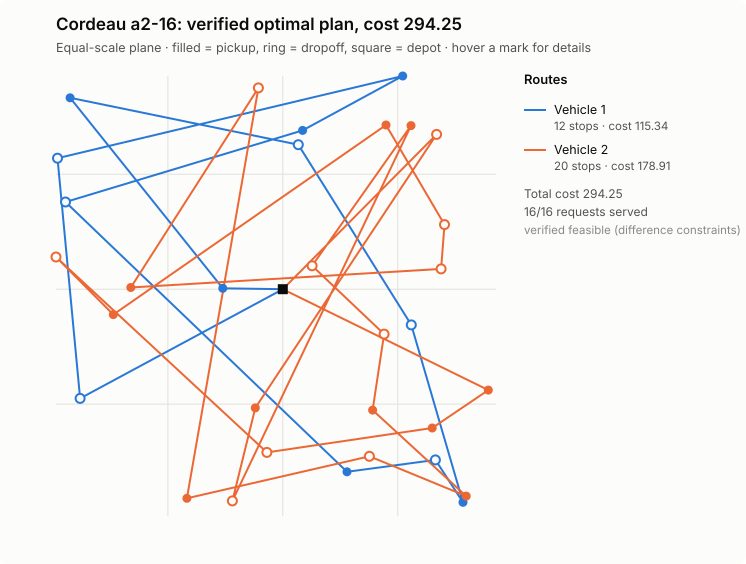
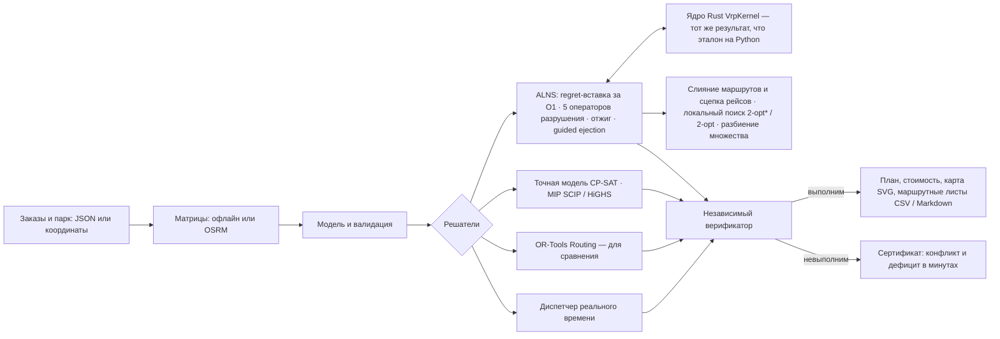
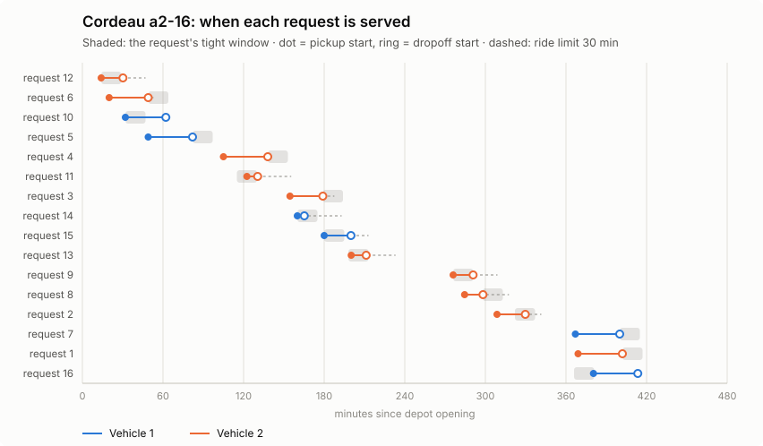
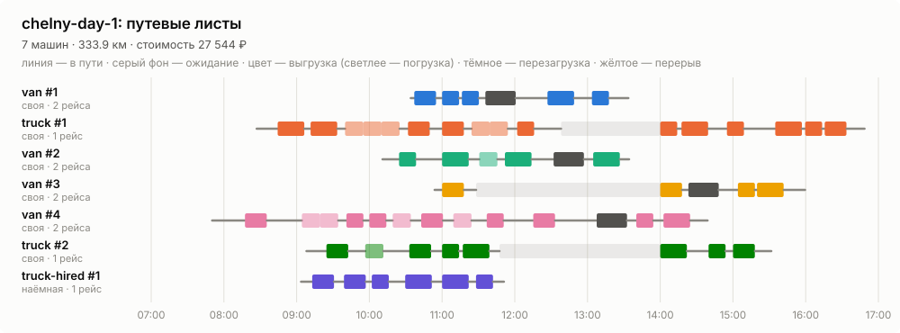

# SynAPS-MobiRoute

Движок маршрутизации для смешанного парка: VRPTW, PDPTW и DARP с вектором
ёмкости (кг, м³, паллеты), требованиями к машине, сменами, своими и наёмными
машинами, режимом труда и отдыха водителей, несколькими рейсами за смену и
пробками по часам суток. ALNS на ядре Rust и локальный поиск, точные модели
CP-SAT и MIP, сравнение с OR-Tools, диспетчеризация заявок в реальном времени,
ввод в координатах с матрицами OSRM и Valhalla, зоны ограничений для грузовиков
и маршрутные листы — и независимая проверка каждого плана.

> **Коротко.** Открытый движок, который строит маршруты для смешанного парка
> грузовиков и фургонов, своих и наёмных: окна доставки, вес, объём и паллеты,
> режим труда и отдыха водителей (включая перерыв 15 + 30 мин), несколько
> рейсов за смену, зоны запрета для тяжёлых машин. Каждый план проверяет
> независимая программа, и на выходе — маршрутный лист для водителя. Против
> Google OR-Tools при равном времени: лучше на 15 задачах из 18, хуже — ни на
> одной; на грузовых днях на 17–18% дешевле и на две машины меньше. Python и
> Rust, около 600 тестов, документация на русском и английском, интерактивный
> [сайт](https://konkovdv.github.io/SynAPS-MobiRoute/). Автор — Дмитрий
> Коньков ([GitHub](https://github.com/KonkovDV)).

Язык: **RU** | [EN](README.en.md) · Сайт: [konkovdv.github.io/SynAPS-MobiRoute](https://konkovdv.github.io/SynAPS-MobiRoute/)

[](https://github.com/KonkovDV/SynAPS-MobiRoute/actions/workflows/ci.yml)
[](https://www.python.org/)
[](native/mobiroute_native)
[](docs/benchmarks)
[](https://mypy-lang.org/)
[](https://github.com/astral-sh/ruff)
[](LICENSE)

Любой план — от эвристики, точной модели или OR-Tools — проходит отдельный
верификатор: загрузка, расписание и стоимость пересчитываются заново, решателю
ничего не доверяется. Если рейс невозможен, вы получаете не «infeasible», а
**сертификат**: какие ограничения конфликтуют и **сколько минут не хватает**.



## Задачи вакансии → где это в репозитории

Репозиторий собран под задачи программиста-алгоритмиста в грузовой
логистике: VRP с временными окнами, забором и доставкой и разнородным парком;
выбор MIP/CP-решателей, эвристик и метаэвристик; продуктовый код, ревью и
документация. Каждая строка ведёт к коду и к замеру, который можно повторить
одной командой.

| Задача | Что сделано | Где проверить |
| --- | --- | --- |
| VRP с окнами, забором и доставкой, разнородным парком | одна модель для VRPTW, PDPTW и DARP: вектор ёмкости, навыки, смены, свои и наёмные машины, режим труда и отдыха с перерывом 15 + 30, несколько рейсов, пробки по часам, зоны запрета для грузовиков | [модель](src/mobiroute/vrp/model.py) · [Solomon 56 из 56](docs/benchmarks/vrp-public-benchmarks.md) |
| Выбор MIP/CP-решателя | одна и та же модель на CP-SAT, SCIP, HiGHS и CBC, LP-граница; решатель выбирается по замеру на своём классе задач | [Cordeau a2-16](docs/benchmarks/solver-lab-a2-16.md) · [разбиение множества](docs/benchmarks/setpart-solvers.md) |
| Эвристики и метаэвристики | regret-k, ALNS с отжигом, guided ejection, слияние маршрутов, локальный поиск с проверкой окон за O(1) | [40 из 40 оптимумов](docs/benchmarks/exact-vs-alns.md) · [против OR-Tools](docs/benchmarks/ortools-vs-alns.md) |
| LP/IP, теория графов, комбинаторная оптимизация | разностные ограничения и Беллман–Форд с сертификатами, поток минимальной стоимости для выбора типов машин, set partitioning, четыре леммы с доказательствами | [постановка](docs/mathematical-formulation.md) · [ниже](#математика-на-одном-экране) |
| Продуктовый код | CLI, ввод в координатах, матрицы OSRM, маршрутные листы CSV / Markdown / SVG, коды ошибок, ядро на Rust | [от координат к маршрутным листам](#из-координат--в-маршрутные-листы) |
| Python: ООП, тесты, профилирование | неизменяемые модели на dataclass, `mypy --strict`, 585 тестов (9 свойств Hypothesis), профилирование → ядро Rust в 10–49 раз быстрее при том же плане | [тесты](tests) · [ускорение](docs/native-acceleration.md) |
| Ревью кода и документация | правила ревью, CI (ruff, mypy, clippy, тесты, смоук-прогоны CLI), документация на русском и английском, журнал изменений | [CONTRIBUTING](CONTRIBUTING.md) · [архитектура](docs/architecture.md) · [CHANGELOG](CHANGELOG.md) |
| Риск: данные только синтетические | открытые эталоны, в том числе на реальных дорожных временах OSRM и на 1000 клиентов; данные перевозчика входят координатами и матрицами его маршрутизатора (OSRM, Valhalla с грузовым профилем) | [область применения](docs/limitations.md) · [практика РФ](docs/trucking-ru.md) |

## Результаты

| Что проверяем | Результат | Как воспроизвести |
| --- | --- | --- |
| 130 открытых эталонов: Solomon (VRPTW), Li & Lim и Sartori–Buriol (PDPTW, реальные дорожные времена OSRM), Cordeau (DARP) | все 130 планов проверены и обслуживают все заказы. Solomon: **56 из 56** — с числом машин лучшего известного решения, медиана разрыва 0.50%, 20 совпадений, худший случай 7.0%. Sartori–Buriol: 22 из 25, медиана 0.92%. Cordeau: 19 из 48 — опубликованный оптимум, средний разрыв 0.50% | `python benchmark/vrp_benchmark.py` → [таблица](docs/benchmarks/vrp-public-benchmarks.md) |
| ALNS против доказанного оптимума | CP-SAT доказал оптимум на 40 из 40 случайных задач полной модели (2–3 типа машин, вектор ёмкости, навыки, лимит поездки, смены); ALNS находит его в **40 из 40** за 0.15 с (CP-SAT — 1.1 с). Два прежних промаха закрыл оператор слияния маршрутов на машину другого типа | `python benchmark/exact_vs_alns.py` → [таблица](docs/benchmarks/exact-vs-alns.md) |
| OR-Tools Routing (PCI + GLS) при равном времени | 18 задач, по 10 с каждому, один верификатор: ALNS не хуже нигде. RC201: +0.79% против +7.81%; bar-n100-1 (дороги OSRM) +0.14% против +8.61%; на RC101, ber-, nyc-, poa-n100-1 — на 1–2 машины меньше; на a2-16 OR-Tools теряет заказ; грузовые дни со смешанным парком дешевле на **17–18%** и на две машины меньше | `python benchmark/ortools_vs_alns.py` → [таблица](docs/benchmarks/ortools-vs-alns.md) |
| Заявки в реальном времени | ответ на заявку в среднем за **0.1 мс** (95% — не дольше 0.22 мс): вставка в непроеханную часть плана; ALNS раз в 30 минут снижает стоимость (завод, 140 перевозок: −1.2%). Полный пересчёт OR-Tools на каждую заявку (3 с) принимает 86.4% против 83.6% и дешевле ещё на 1.6%, но отвечает за 2.9 с — в десятки тысяч раз дольше — и подаёт машину в среднем на 5 минут позже. Все итоговые планы проверены | `python benchmark/realtime_dispatch.py --with-ortools` → [таблица](docs/benchmarks/realtime-dispatch.md) |
| Профилирование → ядро на Rust | ALNS с ядром на Rust быстрее эталона на Python в **10–49 раз** (VRPTW ×10, PDPTW ×17, DARP ×49) — при **бит-в-бит одинаковом** результате, в том числе с перерывами и рейсами; на дне с 8 типами машин ×5.4: узким местом стали операторы на Python (подбор типов, слияние) | `python benchmark/measure_vrp_speed.py` → [таблица](docs/benchmarks/vrp-speed.md) |
| Выбор MIP/CP-решателя, Cordeau a2-16 | CP-SAT доказывает оптимум 294.25 за 0.7 с; SCIP — 26.2 с, HiGHS — 41.3 с; CBC за 60 с — разрыв 20%; LP-релаксация 85.27 (слабость big-M). ALNS находит тот же оптимум за 3.0 с; OR-Tools за 10 с теряет одну заявку из 16 | `python benchmark/solver_lab.py` → [таблица](docs/benchmarks/solver-lab-a2-16.md) |
| Выбор решателя для разбиения множества | одна модель set partitioning на пулах маршрутов ALNS, 7 задач, по 10 с: на R101/RC101 SCIP, HiGHS, CBC и CP-SAT в 8 потоков доказывают оптимум по пулу за 0.1–0.4 с; CP-SAT в одном потоке со штатными настройками не успевает за 10 с, а с `linearization_level=2` — за 0.1–0.2 с (теперь это настройка движка); на дне с рейсами все четыре находят план на **0.29% лучше ALNS**; на пуле из 6339 маршрутов лучший — CP-SAT в 8 потоков (−0.05%), HiGHS без подсказки решения не находит, CBC выдаёт план на 22.6% хуже. LP-релаксация даёт нижнюю границу по пулу | `python benchmark/setpart_study.py` → [таблица](docs/benchmarks/setpart-solvers.md) |
| Режим труда и отдыха | план грузового дня, построенный без нормы 4,5 ч / 45 мин, на каждом из 5 дней содержит **4–6 маршрутов, где перерыв поставить некуда** (не хватает 94–209 мин суммарно); план с нормой выполним, дороже на 2.0–5.5% | `python benchmark/rules_study.py` → [таблица](docs/benchmarks/rules.md) |
| Несколько рейсов | склад → 60 магазинов, две волны доставки: при одном рейсе на машину даже 21 машина (12 наёмных) обслуживает только 52–55 магазинов; при двух-трёх рейсах — **все 60 на 12–15 машинах** | то же |
| Пробки по часам суток | план на скоростях свободного потока в часы пик ломается на **8–13 маршрутах в день** (113–318 мин опозданий); план с учётом пробок выполним, дороже на 0–11% | то же |
| Статистика по зёрнам | 19 задач Solomon R2/RC2 × 5 зёрен: все прогоны — с эталонным числом машин, разброс разрыва по зёрнам до ±3 п. п. Локальный поиск сокращает план в 61 из 95 парных прогонов (медиана −0.32% от лучшего известного), критерий Уилкоксона **p = 0.006**; RC202 в среднем 8.3% → 6.3%, R211 6.5% → 3.9% | `python benchmark/seed_study.py` → [таблица](docs/benchmarks/seed-study.md) |
| Качество кода | 585 тестов, из них 9 свойств на Hypothesis (сотни случайных маршрутов: проверки поиска и расписание маршрутного листа против независимого верификатора); `mypy --strict`, `ruff`, `clippy -D warnings`; Rust ↔ Python бит в бит | `pytest && ruff check . && mypy` |

Замеры — на одной машине (Linux x86_64, Python 3.13, один поток); это не SLA.

## Сравнение с аналогами

Возможности сверены по документации проектов (14.11.2026); замер — против
OR-Tools. Подробно, с источниками и научными публикациями —
[docs/comparison.md](docs/comparison.md).

| | Этот движок | OR-Tools | VROOM | PyVRP | jsprit | Яндекс Маршрутизация |
| --- | :---: | :---: | :---: | :---: | :---: | :---: |
| Окна, забор и доставка, разнородный парк | ✓ | ✓ | ✓ | ✓ | ✓ | ◐ |
| Несколько рейсов за смену | ✓ | ◐ вручную | н/д | ✓ | н/д | ✓ |
| Перерыв по времени за рулём (4,5 ч → 45 мин, 15 + 30) | ✓ | ◐ интервалы | ◐ окна | Enterprise | н/д | н/д |
| Зоны запрета по массе, высоте, нагрузке на ось; грузовые матрицы | ✓ зоны + Valhalla | — | ◐ через профиль маршрутизатора | — | н/д | н/д |
| Пробки по времени суток | ✓ | н/д | н/д | н/д | ✓ | ✓ |
| Доказанный оптимум на той же модели | ✓ | — | — | — | — | н/д |
| Независимая проверка, сертификат «почему нельзя» | ✓ | н/д | н/д | н/д | н/д | н/д |
| Открытый код | MIT | Apache-2.0 | BSD-2 | MIT | Apache-2.0 | — |

◐ — частично, н/д — не нашли в документации. Измерено при равном времени, 18
задач, один верификатор: **ALNS лучше OR-Tools на 15, наравне на 3, хуже — ни
на одной**; на грузовых днях со смешанным парком дешевле на 16,8–18,3% и на
две машины меньше. Как выбирать: для классических CVRP/VRPTW без правил парка
подходят PyVRP и VROOM, для готового интерфейса логиста — коммерческий сервис;
этот движок — когда нужна своя модель с режимом труда и отдыха, рейсами,
разнородным парком и проверяемым результатом.

## Какие задачи решает

**Городская доставка со своим и наёмным парком.** Фургоны, грузовики, тягач;
у заказа вес, объём, паллеты, окно доставки, рефрижератор, гидроборт или
ДОПОГ. Решатель выпускает сначала свои машины и нанимает только тот класс,
которого не хватает.

**Из координат — в маршрутные листы.** Заказы и парк в координатах, матрицы
офлайн или с сервера OSRM, на выходе — маршрутный лист на каждую машину
(раздел [ниже](#из-координат--в-маршрутные-листы)).

**Распределительный центр с волнами доставки.** Утренние и дневные слоты
магазинов; машина возвращается на склад, загружается снова и уходит во второй
рейс. Смена, лимит вождения и окна проверяются на весь день, ёмкость — на
каждый рейс.

**Режим труда и отдыха и пробки.** Не больше 4,5 ч за рулём до перерыва 45
мин, не больше 9 ч вождения за смену; скорость по часам суток (часы пик).
Если перерыв поставить некуда, верификатор говорит, сколько минут не хватает.

**Внутризаводская логистика.** Перевозки паллет между цехами появляются в
течение смены. Каждая получает ответ за доли миллисекунды — вставку в
непроеханную часть плана или отказ с причиной (из прогона шаттла: «ближайшая
свободная машина доберётся до точки забора через 1.9 мин после закрытия
окна»). Раз в 30 минут живое состояние переоптимизируется.

**Шаттл по требованию.** Поездки между остановками: ожидание не больше 30
минут, ожидание плюс поездка — не больше 45; микроавтобусы на 8 мест.

**Пассажирская перевозка с особыми требованиями** (DARP): лимит времени в
пути, коляски, сопровождающие, водители с допуском — исходное ядро проекта
([docs/darp-kernel.md](docs/darp-kernel.md)).

## Как устроено



| Метод | Когда | Доказывает оптимум |
| --- | --- | --- |
| Regret-k вставка + ALNS (random, worst, Shaw, SISR, route; отжиг) | основной режим | нет |
| Guided ejection (Nagata & Bräysy) | сократить число машин | нет |
| Слияние двух маршрутов на машину другого типа; сцепка рейсов через повторную загрузку на складе | смешанный парк, несколько рейсов | нет |
| Локальный поиск relocate / swap / 2-opt* / 2-opt, окна за O(1) склейкой сегментов (Vidal et al. 2013) | VRPTW, каждый новый лучший план | нет |
| Разбиение множества по пулу маршрутов (CP-SAT, SCIP, HiGHS, CBC) | опция: перекомбинировать найденные маршруты | только по пулу |
| Вставка в живой план | новая заявка в течение дня | нет |
| CP-SAT, по циклу на машину | малые задачи с любыми ограничениями | да, для своей целочисленной модели |
| MIP Furtado–Munari–Morabito на SCIP / HiGHS / CBC | сравнение решателей, нижняя граница | да, по доказательству решателя |
| OR-Tools Routing (PCI + GLS) | эталон для сравнения | нет |
| Минимальное опоздание: бисекция по Беллману–Форду, LP | когда окна нельзя выполнить | да (LP) |

Перерыв водителя удлиняет одно ограничение переезда, поэтому расписание
остаётся системой разностных ограничений и проверка с сертификатами работает
как прежде (лемма 1). При пробках функция прибытия монотонна (FIFO), поэтому
самое раннее расписание остаётся лучшим для окон (леммы 2 и 3).

## Математика на одном экране

**Цель — деньги, а не километры.** Плата за выход $f_k$ (у своей машины 0),
цена километра $c^d_k$ и часа $c^t_k$ типа машины $k$, штраф $\pi_r$ за
необслуженный заказ:

```math
\min \sum_{\text{маршруты}} \Big( f_k + c^d_k \sum d_{ij} + c^t_k \big(\textstyle\sum t_{ij} + \sum s_i\big) \Big) \;+\; \sum_{r\ \text{не обслужен}} \pi_r
```

**Расписание — система разностных ограничений.** Для фиксированного порядка
остановок каждое правило — неравенство $B_v - B_u \le w_{uv}$ на начала
обслуживания:

```math
e_i \le B_i \le l_i, \qquad
B_{i+1} \ge B_i + s_i + t_{i,i+1} \;(+\,b \text{ в промежутке с перерывом}), \qquad
B_{d_r} - B_{p_r} - s_{p_r} \le L_r, \qquad
B_{\text{end}} - B_{\text{start}} \le T_k
```

Система совместна тогда и только тогда, когда в графе ограничений нет
отрицательного цикла. Беллман–Форд находит его, и цикл $C$ становится
сертификатом: $-\sum_{C} w$ — сколько минут не хватает.

**Вставка за O(1)** (Savelsbergh 1992). Прямой и обратный проход по маршруту

```math
\mathrm{begin}_k = \max\big(\mathrm{begin}_{k-1} + s_{k-1} + t_{k-1,k},\; e_k\big), \qquad
\mathrm{late}_k = \min\big(l_k,\; \mathrm{late}_{k+1} - s_k - t_{k,k+1}\big)
```

решают за константу, встаёт ли заказ $u$ между $v_i$ и $v_{i+1}$:
$b_u = \max(\mathrm{begin}_i + s_i + t_{iu},\, e_u) \le l_u$ и
$b_u + s_u + t_{u,i+1} \le \mathrm{late}_{i+1}$.

**Тип машины для готовых маршрутов — транспортная задача.** Маршрут $\rho$
на типе $k$ стоит $\mathrm{cost}_k(\rho)$ ($\infty$, если тип не подходит
по ёмкости, навыкам или времени):

```math
\min \sum_{\rho, k} \mathrm{cost}_k(\rho)\, z_{\rho k}
\quad \text{при} \quad \sum_k z_{\rho k} = 1, \qquad \sum_\rho z_{\rho k} \le n_k, \qquad z \ge 0
```

Матрица ограничений вполне унимодулярна, поэтому LP-решение целочисленно, и
задача решается потоком минимальной стоимости, без MIP.

**Разбиение множества по пулу маршрутов** $\Omega$, найденных ALNS:

```math
\min \sum_{\rho \in \Omega} c_\rho x_\rho + \sum_r \pi_r y_r
\quad \text{при} \quad \sum_{\rho \ni r} x_\rho + y_r = 1 \;\; \forall r, \qquad
\sum_{\rho \in \Omega_k} x_\rho \le n_k, \qquad x \in \{0, 1\}^{\Omega}
```

**Когда выезжать (лемма 4).** Пусть $E$ — самое раннее возвращение, $c$ —
кратчайшая длительность смены, $U_0$ — самый поздний выезд. Тогда при выезде в
$t_0 \le U_0$ смена длится

```math
D(t_0) = \max\big(E - t_0,\; c\big), \qquad t_0^{*} = E - c .
```

Выезд в $t_0^{*}$ даёт сразу и кратчайшую смену, и самое раннее возвращение.
На синтетическом дне в Челнах это 14,8 ч времени смены в день при тех же
маршрутах; на [сайте](https://konkovdv.github.io/SynAPS-MobiRoute/#sheets)
график $D(t_0)$ можно двигать руками. Доказательства всех четырёх лемм —
в [docs/mathematical-formulation.md](docs/mathematical-formulation.md).

## «Почему нельзя?» — сертификат

Грузовой день: перевозка от поставщика к клиенту.

```text
Рейс невозможен при любом расписании: не хватает 8.8 мин.
поставщик: начало не раньше 09:00 (погрузка 26 мин);
переезд поставщик → клиент: 162.8 мин;
клиент: начало разгрузки не позже 12:00.
```

Проверка вручную: 540 + 26 + 162.8 − 720 = 8.8. Сертификат — отрицательный цикл
в графе разностных ограничений; его вес и есть дефицит. Логист сразу видит, что
менять: окно клиента или время у поставщика.



## Из координат — в маршрутные листы

Заказы и парк можно задать так, как их выгружает учётная система: склад с
часами работы, заказ с окном «08:00–11:00», погрузка на складе или у
поставщика, вес, объём и паллеты, требования к машине; типы машин со сменой,
ценой километра и часа, нормой отдыха и числом рейсов. Формат
`mobiroute.vrp.geo.v1` описан в [docs/cargo-vrp.md](docs/cargo-vrp.md#данные-из-координат-и-маршрутные-листы).
Матрицы времени и расстояний считаются офлайн (дуга большого круга ×
коэффициент извилистости, средняя скорость профиля) или запрашиваются у
сервера [OSRM](https://project-osrm.org/): сервис `table`, блоками по 100
точек.

```bash
mobiroute vrp-solve --geo examples/chelny-day.geo.json --sheets --out-dir out-chelny
mobiroute vrp-solve --geo examples/chelny-day.geo.json --osrm http://localhost:5000 --sheets --out-dir out-osrm
```

Кроме плана и карты получается маршрутный лист на каждую машину:
`route-sheets.md` для людей, `route-sheets.csv` для учётной системы и
`route-sheets.svg` — диаграмма Ганта всего дня. В листе — прибытие, начало и
конец работ на каждой точке, загрузка после неё по каждому измерению,
повторная загрузка между рейсами, перерыв водителя и проверка режима труда и
отдыха: самый длинный отрезок за рулём до перерыва, вождение за смену и
длительность смены против лимитов. Машина выезжает так поздно, как позволяет
самое раннее возвращение, и не стоит час у ворот первого клиента. Это
расписание кратчайшее по длительности смены (лемма 4 в
[docs/mathematical-formulation.md](docs/mathematical-formulation.md#4d-the-schedule-handed-to-the-driver)),
а тесты сверяют его с каждым ограничением верификатора.

> Маршрутный лист — план рейса для водителя, а не путевой лист: путевой лист обязателен по ст. 6 Устава автомобильного транспорта (259-ФЗ), его реквизиты (сведения о машине и водителе, показания одометра, отметки о медосмотрах и о контроле технического состояния) установлены приказом Минтранса России № 390 от 28.09.2022 и ведутся в учётной системе; CSV маршрутных листов загружается в неё как задание.



```text
## van #1 · своя · 2 рейса
Начало 10:14, выезд 10:34, возврат 13:34; 36,3 км, за рулём 73 мин, ожидание 0 мин; стоимость 1 999 ₽
Режим труда и отдыха соблюдён: непрерывно за рулём 1:13 / 4:30; за рулём за смену 1:13 / 9:00; смена 3:20 / 10:00.
Порядок загрузки на складе, обратный порядку выгрузки: рейс 1: Z011, Z020, Z014; рейс 2: Z027, Z002.

| Рейс | Что                | Заказ | Где                 | Окно        | Прибытие | Начало | Конец |     kg |
| ---: | ------------------ | ----- | ------------------- | ----------- | -------: | -----: | ----: | -----: |
|    1 | загрузка и выезд   |       | Склад (условн.)     |             |    10:14 |  10:14 | 10:34 | 1427,4 |
|    1 | выгрузка           | Z014  | Клиент 14 (условн.) | 08:00-11:00 |    10:37 |  10:37 | 10:55 |  645,8 |
|    1 | выгрузка           | Z020  | Клиент 20 (условн.) | 11:00-14:00 |    11:00 |  11:00 | 11:14 |  371,1 |
|    1 | выгрузка           | Z011  | Клиент 11 (условн.) | 08:00-18:00 |    11:16 |  11:16 | 11:30 |      0 |
|    2 | загрузка на складе |       | Склад (условн.)     | 07:00-20:00 |    11:36 |  11:36 | 12:01 | 1329,1 |
|    2 | выгрузка           | Z002  | Клиент 2 (условн.)  | 11:00-14:00 |    12:27 |  12:27 | 12:49 |  241,1 |
|    2 | выгрузка           | Z027  | Клиент 27 (условн.) | 08:00-18:00 |    13:04 |  13:04 | 13:18 |      0 |
|    2 | возврат            |       | Склад (условн.)     |             |    13:34 |  13:34 | 13:34 |      0 |
```

Пример — синтетический день в Набережных Челнах: склад, три поставщика, 45
заказов, свои и наёмные фургоны и грузовики. Точки случайны внутри границ
города, названия помечены «условн.»; данные не описывают ни одну компанию
([генератор](examples/make_chelny_day.py)). ALNS за 2.2 с закрывает день семью
машинами: все четыре своих фургона идут в два рейса, из наёмных нужен один
грузовик.

## Быстрый старт

```bash
python -m pip install -e ".[dev]"
python -m pip install maturin
python -m maturin develop --release --manifest-path native/mobiroute_native/Cargo.toml
```

```bash
mobiroute vrp-solve --generate cargo --orders 120 --out-dir out-cargo --svg
mobiroute vrp-solve --instance benchmark/instances/sartori-buriol/n100/bar-n100-1.txt --time-limit 10 --out-dir out-sb --svg
mobiroute vrp-solve --generate cargo --orders 60 --solver ortools --time-limit 10 --out-dir out-ortools
mobiroute vrp-dispatch --day plant --policy insertion+alns --out-dir out-plant
mobiroute vrp-solve --geo examples/chelny-day.geo.json --sheets --out-dir out-chelny
mobiroute literature-benchmark --instance benchmark/instances/cordeau/a2-16.txt --out-dir out-a2 --svg
pytest            # быстрый набор; точные MIP-доказательства: pytest -m slow
```

```python
from mobiroute.vrp import AlnsConfig, geo, load_benchmark, route_sheets, sheets_markdown, solve

inst, sha256 = load_benchmark("benchmark/instances/solomon/R101.txt")
result = solve(inst, AlnsConfig(time_limit=10, seed=1))
print(result.verdict.summary())

day = geo.load("examples/chelny-day.geo.json")  # или osrm="http://localhost:5000"
plan = solve(day.instance, AlnsConfig(time_limit=10, seed=1))
sheets = route_sheets(day.instance, plan.solution, plan.verdict, day.places)
print(sheets_markdown(sheets, day.instance.dimensions, currency=day.currency))
```

Без собранного ядра на Rust движок работает на эталонной реализации Python —
с тем же результатом, только медленнее.

## Документация

| Документ | О чём |
| --- | --- |
| [docs/cargo-vrp.md](docs/cargo-vrp.md) | грузовой VRP: модель, алгоритмы, ввод в координатах, маршрутные листы, сценарии, что дальше |
| [docs/mathematical-formulation.md](docs/mathematical-formulation.md) | постановка, вставка за O(1), разностные ограничения, перерывы, рейсы, пробки, расписание для водителя (леммы с доказательствами), локальный поиск, разбиение множества, LP опоздания, CP-SAT, MIP, статистика сравнений |
| [docs/comparison.md](docs/comparison.md) | сравнение с OR-Tools, VROOM, PyVRP, jsprit, Timefold, Яндекс Маршрутизацией; мировая практика и публикации → что взято в движок |
| [docs/architecture.md](docs/architecture.md) | модули, потоки данных, проектные решения |
| [docs/native-acceleration.md](docs/native-acceleration.md) | профилирование и ядра на Rust |
| [docs/benchmark-protocol.md](docs/benchmark-protocol.md) | правила публикации чисел |
| [docs/benchmarks/](docs/benchmarks) | таблицы всех экспериментов |
| [docs/darp-kernel.md](docs/darp-kernel.md) | пассажирское ядро DARP: правила, диспетчеризация, проверки |
| [docs/trucking-ru.md](docs/trucking-ru.md) | российская практика грузоперевозок: режим труда и отдыха, путевой лист, знаки и зоны, «Платон», ДОПОГ — как каждое правило задаётся в модели |
| [docs/benchmarks/solvers.md](docs/benchmarks/solvers.md) | ALNS, PyVRP, VROOM и jsprit на одних задачах при равном времени |
| [docs/limitations.md](docs/limitations.md) | область применения и развитие |
| [benchmark/instances/README.md](benchmark/instances/README.md) | происхождение эталонов и ссылки |
| [examples/README.md](examples/README.md) | входные файлы примеров и как они получены |
| [CHANGELOG.md](CHANGELOG.md) | что изменилось в каждой версии |

## Область применения и развитие

Движок проверен на открытых эталонах (в том числе с реальными дорожными
временами OSRM и задачами на 1000 клиентов) и на синтетических днях;
подключение к данным перевозчика — это ввод в координатах и матрицы его
маршрутизатора (OSRM или Valhalla с грузовым профилем). Разрыв к лучшим
известным решениям опубликован по каждому инстансу, разброс по зёрнам
измерен, оптимум малых задач доказан точными моделями. Следующие шаги —
запрет въезда по времени суток, многодневные рейсы с суточным отдыхом,
разделённый перерыв и пробки в ядре Rust. Подробно:
[docs/limitations.md](docs/limitations.md), практика РФ —
[docs/trucking-ru.md](docs/trucking-ru.md).

## Лицензия

MIT — см. [LICENSE](LICENSE). Цитирование — [CITATION.cff](CITATION.cff).
