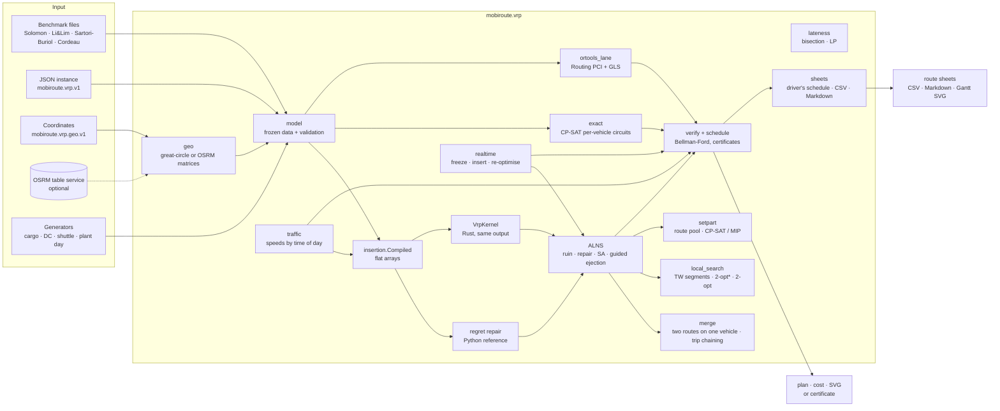

# Architecture

## Packages

| Package | Role |
| --- | --- |
| `vrp` | rich VRP engine: model (rests, reload stops, speed profiles), readers, input in coordinates with offline or OSRM matrices, insertion algebra, ALNS, merge operator, VRPTW local search, set partitioning, exact CP-SAT, OR-Tools lane, lateness, live dispatch, verifier, route sheets, SVG |
| `benchmarks` | Cordeau literature lane (exact CP-SAT and MIP on SCIP/HiGHS/CBC, LP bound, Bellman-Ford verifier) and the claim gate for open-data runs |
| `domain`, `solvers`, `dispatch`, `validation` | paratransit DARP kernel ([darp-kernel.md](darp-kernel.md)) |
| `adapters` | synthetic paratransit days, Cordeau adapter, fingerprints |
| `reporting` | JSON, Markdown, CSV, SVG |
| `native/mobiroute_native` | Rust (PyO3): `VrpKernel` for the rich VRP, `InsertionEngine` for the paratransit kernel |

## Design decisions

**One verifier, no trust in solvers.** Heuristics, CP-SAT, the MIP and
OR-Tools only *propose* plans. `vrp.verify` rebuilds loads from demands,
timing from the difference-constraint graph and cost from the matrices. A
solver's own objective is reported, never used.

**Reference implementation plus kernel.** The repair step is written twice:
readable Python and a Rust port that keeps every floating-point expression in
the same order, the same tie-breaking and the same SplitMix64 noise stream.
Tests require identical plans, down to whole ALNS trajectories, so the fast
path cannot drift from the specification.

**Constant-time tests, exact checks when needed.** Windows, capacity vector,
skills and the shift cap are decided by slack arithmetic; ride limits (which
couple two stops) go to Bellman-Ford for the cheapest candidates only.

**Live state as a static instance.** Dispatch freezes what is already
driven, and re-optimises the rest by writing it as an ordinary instance: a
vehicle's position becomes its depot, orders on board become depot deliveries
locked to it by a private skill. Every solver in the package then works on
live state without special cases.

**Rules are data; lanes say what they do not model.** Rests, reload stops
and speed profiles live in the instance. The heuristics, the Rust kernel and
the verifier implement them; the OR-Tools lane, the exact model and the
dispatcher refuse such instances with an error code instead of silently
ignoring a rule.

**Input at the edge, one model inside.** Coordinates, road matrices and
place names are resolved once by `vrp.geo` into an ordinary `Instance` plus a
list of places; no solver knows about latitude or OSRM. A road-matrix source
is a function `points, profile -> (minutes, kilometres)`, so another routing
engine is one function, and tests replace the HTTP call with a fake.

**Outputs read the verified plan, not the solver.** Route sheets take their
times from the constraint system the verifier checks (`compact_schedule`:
the latest departure that still returns earliest, a shortest schedule by
Lemma 4 of the formulation) and their costs from the cost model, so the sheets
of a plan add up to its verdict.

**Deterministic runs.** Seeds everywhere, SHA-256 of instance bytes in every
benchmark row, one thread unless stated, CP-SAT with one worker in the
literature lane.

**Errors are codes.** Every input problem raises a `ValueError` whose message
starts with a stable code (`GEO_UNKNOWN_DEPOT:van`, `VRP_CAPACITY_INVALID:van`,
`SHEETS_NEED_A_FEASIBLE_PLAN`); the CLI prints it in one line to stderr and
exits with status 2.

## Paths through the code

* `mobiroute vrp-solve --instance F --solver alns` → `io.load_benchmark` →
  `alns.solve` (construction by regret-2 → anneal → route elimination →
  anneal) → `verify.verify` → `solution.json`, `verdict.json`, `routes.svg`.
* `mobiroute vrp-solve --geo day.geo.json [--osrm URL] --sheets` →
  `geo.load` (offline or OSRM `table` matrices, reload stops for multi-trip
  types) → `alns.solve` → `verify.verify` → `sheets.route_sheets`
  (`schedule.compact_schedule` per route) → `route-sheets.csv`,
  `route-sheets.md`, `route-sheets.svg`.
* `mobiroute vrp-dispatch --day plant --policy insertion+alns` →
  `realtime.Dispatcher.run` → per order `_insert` (≈0.1 ms), every 30 min
  `snapshot` → `alns.solve(initial=current plan)` → apply if better.
* `mobiroute literature-benchmark --instance a2-16.txt` →
  `cordeau_exact.solve_exact_cpsat` → `verify_routes` → gated literature report.
